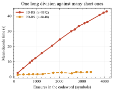

# 1D-RS vs 2D-RS: how they work, and how they compare

> **Superseded in part — 2D-RS geometry changed twice, most recently on
> 2026-09-16.** This document was written when `2D_RS_Galois.py` extended
> each axis 64→128, giving a 128×128 codeword at **4× overhead and rate
> 0.25**. It then moved to 88×88 (1.89×, rate 0.529), and now extends
> 64→88 on one axis and 64→96 on the other, giving an **88×96 codeword at
> 2.06× overhead and rate 0.485** — the closest any grid reachable in this
> field gets to rate 0.5, so that its storage cost is comparable to 1D-RS's
> and BC's 2×. The component codes are [96, 64] and [88, 64]. The
> natural-looking 90×90 cannot be built: a length-*n* NTT needs *n* to
> divide *p*−1, and 90 = 2·3²·5 needs a 3² where this field has only 3¹,
> plus a 5 it does not have at all. Exactly rate 0.5 is unreachable for any
> genuine 2D product code on a 4096-element blob; `2D_RS_Galois.py`
> explains why.
>
> Everything below about *mechanism* — bivariate polynomials, why every row
> and column is independently a codeword, how the cross-axis cascade works —
> still holds. Everything about *numbers* does not. Specifically superseded:
> every "4× overhead", every "16384", every "128×128", the per-line erasure
> budget (now 32 of 96 along a row and 24 of 88 down a column), and the
> measured tolerance (2D-RS recovers every trial to 38% and none from 42%,
> with a 50% threshold of 0.401 — 95% CI 0.399–0.404, from the dense
> threshold refinement described in the benchmark report).
>
> One further correction to the framing below. This document, and the first
> revision of the benchmark report, judged 2D-RS against the rate bound
> 1−*R*. That is the bound for an *MDS* code, and a product code is never
> MDS: its minimum distance is the product of its component distances,
> 33 × 25 = 825, so its actual guarantee is (*d*−1)/*n* = 0.098. The
> measured 0.401 is four times that — the cross-axis cascade
> genuinely outperforms the worst-case guarantee on random erasure
> patterns, which is the interesting result and is not visible if the only
> reference point is 1−*R*. For current measurements see
> [benchmark_1D_2D_BC_report.md](benchmark_1D_2D_BC_report.md).

This document explains the two coding schemes conceptually and summarises
what running the simulations actually shows, framed against the report's
methodology (Phase 2 analytical modelling / Phase 3 empirical benchmarking)
so it can be adapted directly into the write-up. For implementation detail
and the underlying maths, see
[1D_2D_RS_code_walkthrough.md](1D_2D_RS_code_walkthrough.md).

Both simulations are built on the same foundation on purpose: identical
BLS12-381 scalar field, identical EIP-4844 blob-packing convention (via
`blob_generator.py`), identical bit-reversal domain ordering, identical
FFT-based erasure-decode machinery. The only thing that differs between the
two files is the coding scheme's *structure* — one axis vs two. That's what
makes the comparison below a fair one rather than two unrelated
implementations measuring different things.

## Background: why "evaluation form" matters here

Ethereum's blob commitment scheme (KZG, per EIP-4844) requires a blob's 4096
field elements to be interpreted as the **evaluations** of a polynomial at
the 4096th roots of unity, not as its coefficients — this is what lets a KZG
commitment be computed directly against a Lagrange-basis trusted setup with
no transform needed at commit time. Reed-Solomon extension of a blob is
therefore fundamentally an *interpolate, then evaluate on a bigger domain*
operation: recover the low-degree polynomial's coefficients from the known
evaluations (inverse NTT), then evaluate that same polynomial at more points
(NTT). Both schemes below extend this way, which is what keeps the
comparison compatible with "maintaining the use of KZG commitments" as the
report's stated design constraint. (The walkthrough document works this
whole pipeline through with real numbers on a toy field, if you want to see
every intermediate value.)

## The structural difference, at a glance

<figure>
<svg viewBox="0 0 700 300" role="img" aria-label="1D-RS extends one long codeword to double its length; 2D-RS extends a square grid along both axes, quadrupling its area">
<defs><pattern id="hatch" width="7" height="7" patternTransform="rotate(45)" patternUnits="userSpaceOnUse"><line x1="0" y1="0" x2="0" y2="7" stroke="#1d4ed8" stroke-width="2.2"/></pattern><marker id="arrA" markerWidth="9" markerHeight="9" refX="7" refY="3.5" orient="auto"><path d="M0,0 L7,3.5 L0,7 Z" fill="currentColor"/></marker></defs>
<rect x="60" y="60" width="260.0" height="46" fill="#dbeafe" stroke="currentColor" stroke-width="1.1"/>
<rect x="320.0" y="60" width="260.0" height="46" fill="url(#hatch)" stroke="currentColor" stroke-width="1.1"/>
<text x="190.0" y="87.0" text-anchor="middle" font-size="11">k = 4096</text>
<text x="450.0" y="87.0" text-anchor="middle" font-size="11">n-k = 4096 parity</text>
<text x="60" y="48" font-size="12.5" font-weight="700">1D-RS: one codeword, length 4096 &#8594; 8192</text>
<text x="60" y="128" font-size="10.5" fill="#5b6572">2&#215; total overhead &middot; 50% erasure budget, all in one line, no fallback</text>
<rect x="60" y="190" width="96" height="96" fill="#dbeafe" stroke="currentColor" stroke-width="1.1"/>
<rect x="156" y="190" width="96" height="96" fill="url(#hatch)" stroke="currentColor" stroke-width="1.1"/>
<rect x="60" y="286" width="96" height="96" fill="url(#hatch)" stroke="currentColor" stroke-width="1.1"/>
<rect x="156" y="286" width="96" height="96" fill="url(#hatch)" stroke="currentColor" stroke-width="1.1"/>
<text x="108.0" y="242.0" text-anchor="middle" font-size="10">64&#215;64</text>
<text x="108.0" y="256.0" text-anchor="middle" font-size="9">original</text>
<text x="46" y="326" text-anchor="end" font-size="12.5" font-weight="700" transform="rotate(0)">2D-RS:</text>
<text x="268" y="220" font-size="12.5" font-weight="700">grid, 64&#215;64 &#8594; 128&#215;128</text>
<text x="268" y="242" font-size="10.5" fill="#5b6572">4&#215; total overhead (both axes doubled)</text>
<text x="268" y="260" font-size="10.5" fill="#5b6572">50% per line, but recoverable</text>
<text x="268" y="278" font-size="10.5" fill="#5b6572">cells can be rescued across axes</text>
<text x="60" y="408" font-size="9.6" fill="#5b6572">hatched = redundancy introduced by extension (parity), solid = original data</text>
</svg>
<figcaption>1D-RS extends one long codeword to double its length (2× overhead, 50% erasure ceiling with no fallback if exceeded). 2D-RS extends a square grid along both axes (4× overhead in this construction — see the discussion above — 50% per line, but individual cells can be rescued across axes).</figcaption>
</figure>

1D-RS extends one long codeword; 2D-RS extends a grid along two independent
axes. Every other difference discussed below — overhead, erasure-tolerance
behaviour, decode cost — is a *consequence* of this one structural choice,
not an independent design decision.

## 1D-RS: the PeerDAS baseline today

The blob is treated as **one** codeword. All 4096 evaluations define a
single degree-`<4096` polynomial; extension evaluates that polynomial at
8192 points instead of 4096 — a clean **2× total overhead**, which is
exactly what PeerDAS uses today ([10], [11]).

Recovery is a single erasure-decode pass over the whole 8192-length
codeword. Reed-Solomon's textbook guarantee applies directly and
unforgivingly: if at most `n - k = 4096` (50%) of the codeword is missing,
the polynomial (and therefore every missing sample) is recoverable exactly.
If more than that is missing, there is nothing else to try — no partial
credit, no second attempt from a different angle. The simulation's decoder
reflects this precisely: it's a single function call that returns either a
fully recovered codeword or an explicit, immediate failure.

This gives 1D-RS a simple, easy-to-reason-about erasure-tolerance model
(exactly 50%, no exceptions) and a decode cost dominated by one interpolate
step and — when erasures are present — one polynomial division against a
divisor whose degree equals the erasure count.

## 2D-RS: the product code

The blob is reshaped into a 64×64 grid and each axis is extended
independently (64→128), so this simulation's 2D-RS runs at **4× total
overhead** rather than PeerDAS's proposed 2× (matching PeerDAS's ratio
exactly would need non-power-of-two per-axis extension, which complicates
using a clean NTT — this is reported as its own datapoint, since 2D-RS's
real-world overhead is itself one of the trade-offs the report is comparing,
not something to paper over). Structurally, the 64×64 array of original
values defines a bivariate polynomial `P(x,y) = Σ c_{i,j} x^i y^j` of degree
`<64` in each variable independently. Fixing either variable at *any* value
— including one of the 64 "extension" points that variable's axis
introduces, not just an original point — leaves a polynomial in the other
variable that is still degree `<64` (holding one variable fixed can only
collapse coefficients together, never raise the degree in the variable left
free). Because of that, **every** row of the fully-extended 128×128 grid —
not just the original 64 — is itself a valid degree-`<64` RS codeword in the
column direction, and likewise every column in the row direction. That
single fact is what makes 2D-RS a genuine product code rather than "two
unrelated 1D-RS codes stapled together", and it's what the decoder relies
on. (The walkthrough document derives this in full and shows the decoder
code that depends on it.)

### Where 2D-RS's advantage over 1D-RS actually comes from

Per-line, along a single axis, 2D-RS's erasure budget is smaller in
absolute terms than 1D-RS's: `n - k = 64` per row or column, against a
domain of 128 — the *same 50% ratio* as 1D-RS, just applied to a much
shorter line. Taken alone, that's not an improvement. The improvement comes
from **iteration between the two axes**: a cell whose row has too many
erasures to recover alone, and whose column also has too many erasures to
recover alone, can still become recoverable once *either* axis clears enough
of its neighbouring cells for the *other* axis to now fall within budget.

<figure>
<svg viewBox="0 0 760 400" role="img" aria-label="A cell too erased for its row or column alone becomes recoverable once the other axis runs first -- a mechanism 1D-RS cannot have, since it has only one axis and no fallback">
<defs><marker id="arrB" markerWidth="9" markerHeight="9" refX="7" refY="3.5" orient="auto"><path d="M0,0 L7,3.5 L0,7 Z" fill="currentColor"/></marker></defs>
<text x="118" y="36" text-anchor="middle" font-size="11.5" font-weight="700">Before decoding</text>
<rect x="40" y="50" width="26" height="26" fill="#fecaca" stroke="#dc2626" stroke-width="1.4"/>
<rect x="66" y="50" width="26" height="26" fill="#fecaca" stroke="#dc2626" stroke-width="1.4"/>
<rect x="92" y="50" width="26" height="26" fill="#fecaca" stroke="#dc2626" stroke-width="1.4"/>
<rect x="118" y="50" width="26" height="26" fill="#f6f7f9" stroke="currentColor" stroke-width="0.7"/>
<rect x="144" y="50" width="26" height="26" fill="#f6f7f9" stroke="currentColor" stroke-width="0.7"/>
<rect x="170" y="50" width="26" height="26" fill="#f6f7f9" stroke="currentColor" stroke-width="0.7"/>
<rect x="40" y="76" width="26" height="26" fill="#fecaca" stroke="#dc2626" stroke-width="1.4"/>
<rect x="66" y="76" width="26" height="26" fill="#f6f7f9" stroke="currentColor" stroke-width="0.7"/>
<rect x="92" y="76" width="26" height="26" fill="#f6f7f9" stroke="currentColor" stroke-width="0.7"/>
<rect x="118" y="76" width="26" height="26" fill="#f6f7f9" stroke="currentColor" stroke-width="0.7"/>
<rect x="144" y="76" width="26" height="26" fill="#f6f7f9" stroke="currentColor" stroke-width="0.7"/>
<rect x="170" y="76" width="26" height="26" fill="#f6f7f9" stroke="currentColor" stroke-width="0.7"/>
<rect x="40" y="102" width="26" height="26" fill="#f6f7f9" stroke="currentColor" stroke-width="0.7"/>
<rect x="66" y="102" width="26" height="26" fill="#f6f7f9" stroke="currentColor" stroke-width="0.7"/>
<rect x="92" y="102" width="26" height="26" fill="#f6f7f9" stroke="currentColor" stroke-width="0.7"/>
<rect x="118" y="102" width="26" height="26" fill="#f6f7f9" stroke="currentColor" stroke-width="0.7"/>
<rect x="144" y="102" width="26" height="26" fill="#f6f7f9" stroke="currentColor" stroke-width="0.7"/>
<rect x="170" y="102" width="26" height="26" fill="#f6f7f9" stroke="currentColor" stroke-width="0.7"/>
<rect x="40" y="128" width="26" height="26" fill="#f6f7f9" stroke="currentColor" stroke-width="0.7"/>
<rect x="66" y="128" width="26" height="26" fill="#f6f7f9" stroke="currentColor" stroke-width="0.7"/>
<rect x="92" y="128" width="26" height="26" fill="#f6f7f9" stroke="currentColor" stroke-width="0.7"/>
<rect x="118" y="128" width="26" height="26" fill="#f6f7f9" stroke="currentColor" stroke-width="0.7"/>
<rect x="144" y="128" width="26" height="26" fill="#f6f7f9" stroke="currentColor" stroke-width="0.7"/>
<rect x="170" y="128" width="26" height="26" fill="#f6f7f9" stroke="currentColor" stroke-width="0.7"/>
<rect x="40" y="154" width="26" height="26" fill="#f6f7f9" stroke="currentColor" stroke-width="0.7"/>
<rect x="66" y="154" width="26" height="26" fill="#f6f7f9" stroke="currentColor" stroke-width="0.7"/>
<rect x="92" y="154" width="26" height="26" fill="#f6f7f9" stroke="currentColor" stroke-width="0.7"/>
<rect x="118" y="154" width="26" height="26" fill="#f6f7f9" stroke="currentColor" stroke-width="0.7"/>
<rect x="144" y="154" width="26" height="26" fill="#f6f7f9" stroke="currentColor" stroke-width="0.7"/>
<rect x="170" y="154" width="26" height="26" fill="#f6f7f9" stroke="currentColor" stroke-width="0.7"/>
<rect x="40" y="180" width="26" height="26" fill="#f6f7f9" stroke="currentColor" stroke-width="0.7"/>
<rect x="66" y="180" width="26" height="26" fill="#f6f7f9" stroke="currentColor" stroke-width="0.7"/>
<rect x="92" y="180" width="26" height="26" fill="#f6f7f9" stroke="currentColor" stroke-width="0.7"/>
<rect x="118" y="180" width="26" height="26" fill="#f6f7f9" stroke="currentColor" stroke-width="0.7"/>
<rect x="144" y="180" width="26" height="26" fill="#f6f7f9" stroke="currentColor" stroke-width="0.7"/>
<rect x="170" y="180" width="26" height="26" fill="#f6f7f9" stroke="currentColor" stroke-width="0.7"/>
<text x="40" y="224" text-anchor="start" font-size="9.6" fill="#5b6572">col 0 &#8804; budget, row 0 &gt; budget</text>
<text x="338" y="36" text-anchor="middle" font-size="11.5" font-weight="700">After axis 1 (vertical)</text>
<rect x="260" y="50" width="26" height="26" fill="#bbf7d0" stroke="#16a34a" stroke-width="1.4"/>
<rect x="286" y="50" width="26" height="26" fill="#fecaca" stroke="#dc2626" stroke-width="1.4"/>
<rect x="312" y="50" width="26" height="26" fill="#fecaca" stroke="#dc2626" stroke-width="1.4"/>
<rect x="338" y="50" width="26" height="26" fill="#f6f7f9" stroke="currentColor" stroke-width="0.7"/>
<rect x="364" y="50" width="26" height="26" fill="#f6f7f9" stroke="currentColor" stroke-width="0.7"/>
<rect x="390" y="50" width="26" height="26" fill="#f6f7f9" stroke="currentColor" stroke-width="0.7"/>
<rect x="260" y="76" width="26" height="26" fill="#bbf7d0" stroke="#16a34a" stroke-width="1.4"/>
<rect x="286" y="76" width="26" height="26" fill="#f6f7f9" stroke="currentColor" stroke-width="0.7"/>
<rect x="312" y="76" width="26" height="26" fill="#f6f7f9" stroke="currentColor" stroke-width="0.7"/>
<rect x="338" y="76" width="26" height="26" fill="#f6f7f9" stroke="currentColor" stroke-width="0.7"/>
<rect x="364" y="76" width="26" height="26" fill="#f6f7f9" stroke="currentColor" stroke-width="0.7"/>
<rect x="390" y="76" width="26" height="26" fill="#f6f7f9" stroke="currentColor" stroke-width="0.7"/>
<rect x="260" y="102" width="26" height="26" fill="#f6f7f9" stroke="currentColor" stroke-width="0.7"/>
<rect x="286" y="102" width="26" height="26" fill="#f6f7f9" stroke="currentColor" stroke-width="0.7"/>
<rect x="312" y="102" width="26" height="26" fill="#f6f7f9" stroke="currentColor" stroke-width="0.7"/>
<rect x="338" y="102" width="26" height="26" fill="#f6f7f9" stroke="currentColor" stroke-width="0.7"/>
<rect x="364" y="102" width="26" height="26" fill="#f6f7f9" stroke="currentColor" stroke-width="0.7"/>
<rect x="390" y="102" width="26" height="26" fill="#f6f7f9" stroke="currentColor" stroke-width="0.7"/>
<rect x="260" y="128" width="26" height="26" fill="#f6f7f9" stroke="currentColor" stroke-width="0.7"/>
<rect x="286" y="128" width="26" height="26" fill="#f6f7f9" stroke="currentColor" stroke-width="0.7"/>
<rect x="312" y="128" width="26" height="26" fill="#f6f7f9" stroke="currentColor" stroke-width="0.7"/>
<rect x="338" y="128" width="26" height="26" fill="#f6f7f9" stroke="currentColor" stroke-width="0.7"/>
<rect x="364" y="128" width="26" height="26" fill="#f6f7f9" stroke="currentColor" stroke-width="0.7"/>
<rect x="390" y="128" width="26" height="26" fill="#f6f7f9" stroke="currentColor" stroke-width="0.7"/>
<rect x="260" y="154" width="26" height="26" fill="#f6f7f9" stroke="currentColor" stroke-width="0.7"/>
<rect x="286" y="154" width="26" height="26" fill="#f6f7f9" stroke="currentColor" stroke-width="0.7"/>
<rect x="312" y="154" width="26" height="26" fill="#f6f7f9" stroke="currentColor" stroke-width="0.7"/>
<rect x="338" y="154" width="26" height="26" fill="#f6f7f9" stroke="currentColor" stroke-width="0.7"/>
<rect x="364" y="154" width="26" height="26" fill="#f6f7f9" stroke="currentColor" stroke-width="0.7"/>
<rect x="390" y="154" width="26" height="26" fill="#f6f7f9" stroke="currentColor" stroke-width="0.7"/>
<rect x="260" y="180" width="26" height="26" fill="#f6f7f9" stroke="currentColor" stroke-width="0.7"/>
<rect x="286" y="180" width="26" height="26" fill="#f6f7f9" stroke="currentColor" stroke-width="0.7"/>
<rect x="312" y="180" width="26" height="26" fill="#f6f7f9" stroke="currentColor" stroke-width="0.7"/>
<rect x="338" y="180" width="26" height="26" fill="#f6f7f9" stroke="currentColor" stroke-width="0.7"/>
<rect x="364" y="180" width="26" height="26" fill="#f6f7f9" stroke="currentColor" stroke-width="0.7"/>
<rect x="390" y="180" width="26" height="26" fill="#f6f7f9" stroke="currentColor" stroke-width="0.7"/>
<text x="260" y="224" text-anchor="start" font-size="9.6" fill="#5b6572">col 0 fixed &#8594; row 0 now &#8804; budget</text>
<text x="558" y="36" text-anchor="middle" font-size="11.5" font-weight="700">After axis 2 (horizontal)</text>
<rect x="480" y="50" width="26" height="26" fill="#bbf7d0" stroke="#16a34a" stroke-width="1.4"/>
<rect x="506" y="50" width="26" height="26" fill="#bbf7d0" stroke="#16a34a" stroke-width="1.4"/>
<rect x="532" y="50" width="26" height="26" fill="#bbf7d0" stroke="#16a34a" stroke-width="1.4"/>
<rect x="558" y="50" width="26" height="26" fill="#f6f7f9" stroke="currentColor" stroke-width="0.7"/>
<rect x="584" y="50" width="26" height="26" fill="#f6f7f9" stroke="currentColor" stroke-width="0.7"/>
<rect x="610" y="50" width="26" height="26" fill="#f6f7f9" stroke="currentColor" stroke-width="0.7"/>
<rect x="480" y="76" width="26" height="26" fill="#bbf7d0" stroke="#16a34a" stroke-width="1.4"/>
<rect x="506" y="76" width="26" height="26" fill="#f6f7f9" stroke="currentColor" stroke-width="0.7"/>
<rect x="532" y="76" width="26" height="26" fill="#f6f7f9" stroke="currentColor" stroke-width="0.7"/>
<rect x="558" y="76" width="26" height="26" fill="#f6f7f9" stroke="currentColor" stroke-width="0.7"/>
<rect x="584" y="76" width="26" height="26" fill="#f6f7f9" stroke="currentColor" stroke-width="0.7"/>
<rect x="610" y="76" width="26" height="26" fill="#f6f7f9" stroke="currentColor" stroke-width="0.7"/>
<rect x="480" y="102" width="26" height="26" fill="#f6f7f9" stroke="currentColor" stroke-width="0.7"/>
<rect x="506" y="102" width="26" height="26" fill="#f6f7f9" stroke="currentColor" stroke-width="0.7"/>
<rect x="532" y="102" width="26" height="26" fill="#f6f7f9" stroke="currentColor" stroke-width="0.7"/>
<rect x="558" y="102" width="26" height="26" fill="#f6f7f9" stroke="currentColor" stroke-width="0.7"/>
<rect x="584" y="102" width="26" height="26" fill="#f6f7f9" stroke="currentColor" stroke-width="0.7"/>
<rect x="610" y="102" width="26" height="26" fill="#f6f7f9" stroke="currentColor" stroke-width="0.7"/>
<rect x="480" y="128" width="26" height="26" fill="#f6f7f9" stroke="currentColor" stroke-width="0.7"/>
<rect x="506" y="128" width="26" height="26" fill="#f6f7f9" stroke="currentColor" stroke-width="0.7"/>
<rect x="532" y="128" width="26" height="26" fill="#f6f7f9" stroke="currentColor" stroke-width="0.7"/>
<rect x="558" y="128" width="26" height="26" fill="#f6f7f9" stroke="currentColor" stroke-width="0.7"/>
<rect x="584" y="128" width="26" height="26" fill="#f6f7f9" stroke="currentColor" stroke-width="0.7"/>
<rect x="610" y="128" width="26" height="26" fill="#f6f7f9" stroke="currentColor" stroke-width="0.7"/>
<rect x="480" y="154" width="26" height="26" fill="#f6f7f9" stroke="currentColor" stroke-width="0.7"/>
<rect x="506" y="154" width="26" height="26" fill="#f6f7f9" stroke="currentColor" stroke-width="0.7"/>
<rect x="532" y="154" width="26" height="26" fill="#f6f7f9" stroke="currentColor" stroke-width="0.7"/>
<rect x="558" y="154" width="26" height="26" fill="#f6f7f9" stroke="currentColor" stroke-width="0.7"/>
<rect x="584" y="154" width="26" height="26" fill="#f6f7f9" stroke="currentColor" stroke-width="0.7"/>
<rect x="610" y="154" width="26" height="26" fill="#f6f7f9" stroke="currentColor" stroke-width="0.7"/>
<rect x="480" y="180" width="26" height="26" fill="#f6f7f9" stroke="currentColor" stroke-width="0.7"/>
<rect x="506" y="180" width="26" height="26" fill="#f6f7f9" stroke="currentColor" stroke-width="0.7"/>
<rect x="532" y="180" width="26" height="26" fill="#f6f7f9" stroke="currentColor" stroke-width="0.7"/>
<rect x="558" y="180" width="26" height="26" fill="#f6f7f9" stroke="currentColor" stroke-width="0.7"/>
<rect x="584" y="180" width="26" height="26" fill="#f6f7f9" stroke="currentColor" stroke-width="0.7"/>
<rect x="610" y="180" width="26" height="26" fill="#f6f7f9" stroke="currentColor" stroke-width="0.7"/>
<text x="480" y="224" text-anchor="start" font-size="9.6" fill="#5b6572">row 0 fixed &#8594; converged</text>
<line x1="204" y1="128" x2="252" y2="128" stroke="currentColor" stroke-width="1.3" marker-end="url(#arrB)"/>
<line x1="424" y1="128" x2="472" y2="128" stroke="currentColor" stroke-width="1.3" marker-end="url(#arrB)"/>
<line x1="40" y1="256" x2="720" y2="256" stroke="currentColor" stroke-width="0.6" opacity="0.35"/>
<text x="40" y="278" font-size="11" font-weight="700">1D-RS has no second axis to try:</text>
<rect x="40.0" y="288" width="41.333333333333336" height="26" fill="#f6f7f9" stroke="currentColor" stroke-width="0.9"/>
<rect x="81.33333333333334" y="288" width="41.333333333333336" height="26" fill="#f6f7f9" stroke="currentColor" stroke-width="0.9"/>
<rect x="122.66666666666667" y="288" width="41.333333333333336" height="26" fill="#f6f7f9" stroke="currentColor" stroke-width="0.9"/>
<rect x="164.0" y="288" width="41.333333333333336" height="26" fill="#f6f7f9" stroke="currentColor" stroke-width="0.9"/>
<rect x="205.33333333333334" y="288" width="41.333333333333336" height="26" fill="#fecaca" stroke="#dc2626" stroke-width="0.9"/>
<rect x="246.66666666666669" y="288" width="41.333333333333336" height="26" fill="#fecaca" stroke="#dc2626" stroke-width="0.9"/>
<rect x="288.0" y="288" width="41.333333333333336" height="26" fill="#fecaca" stroke="#dc2626" stroke-width="0.9"/>
<rect x="329.33333333333337" y="288" width="41.333333333333336" height="26" fill="#fecaca" stroke="#dc2626" stroke-width="0.9"/>
<rect x="370.6666666666667" y="288" width="41.333333333333336" height="26" fill="#fecaca" stroke="#dc2626" stroke-width="0.9"/>
<rect x="412.0" y="288" width="41.333333333333336" height="26" fill="#f6f7f9" stroke="currentColor" stroke-width="0.9"/>
<rect x="453.33333333333337" y="288" width="41.333333333333336" height="26" fill="#f6f7f9" stroke="currentColor" stroke-width="0.9"/>
<rect x="494.6666666666667" y="288" width="41.333333333333336" height="26" fill="#f6f7f9" stroke="currentColor" stroke-width="0.9"/>
<rect x="536.0" y="288" width="41.333333333333336" height="26" fill="#f6f7f9" stroke="currentColor" stroke-width="0.9"/>
<rect x="577.3333333333334" y="288" width="41.333333333333336" height="26" fill="#f6f7f9" stroke="currentColor" stroke-width="0.9"/>
<rect x="618.6666666666667" y="288" width="41.333333333333336" height="26" fill="#f6f7f9" stroke="currentColor" stroke-width="0.9"/>
<text x="40" y="332" font-size="10" fill="#dc2626">erasures here exceed the one-and-only axis&#8217;s budget &#8594;</text>
<text x="40" y="348" font-size="10" fill="#dc2626">permanently lost, no second axis to attempt a rescue.</text>
</svg>
<figcaption>The same rescue mechanism as the walkthrough document's worked example, with a direct 1D-RS contrast: the strip at the bottom has no second axis to fall back on, so erasures beyond its one budget are simply unrecoverable — the structural reason a product code tolerates more than either axis's own budget would suggest in isolation.</figcaption>
</figure>

This is genuinely iterative — the simulation's decoder alternates vertical
and horizontal passes until convergence, not a fixed two-pass schedule —
and it means 2D-RS can successfully recover erasure patterns that neither
axis's own 50%-of-128 budget could resolve in isolation, at the cost of only
needing a second pass. 1D-RS, with no second axis, has no equivalent
recourse: as the strip at the bottom of the figure shows, erasures that
exceed the one axis's budget are simply gone — there is no other pass, no
other read of the data, that could ever recover them. This isn't a missing
feature of the 1D-RS script; it's a structural fact about having a single
axis, and it's the mechanism-level reason a product code is more than "the
same code, run twice."

The trade-off for that extra tolerance is the 4× storage/bandwidth overhead
(vs 1D-RS's 2×), which lines up with the report's anticipated finding that
2D-RS "may allow for reduced network bandwidth requirements for random data
availability proofs" while "introduc[ing] increased storage commitments for
parity data" [24] — the storage side of that trade-off is directly visible
in this simulation's overhead numbers, even before any network-layer
bandwidth modelling is added.

## Empirical results from the simulations

These come from actual runs of both scripts (see the walkthrough document
for the verification methodology), and illustrate the kind of Phase 3
dataset this pair of scripts is built to produce.

| | 1D-RS | 2D-RS |
|---|---|---|
| Total overhead | 2× (4096 → 8192) | 4× (4096 → 16384) |
| Per-codeword/per-line erasure ceiling | 50% of 8192, single shot | 50% of 128 per line, but iterable across axes |
| Decode strategy | One-shot: succeeds or fails outright | Iterative: alternates passes until convergence or genuinely stuck |
| Random 15% erasure rate | recovered fully | recovered fully (converged round 1) |
| Random 35% erasure rate | *(not run at this rate — see note below)* | recovered fully (converged round 1) |
| Random 55% erasure rate | **failed immediately** (above the 50% ceiling) | *(not directly tested at this rate)* |
| Decode cost driver | one polynomial division, degree = erasure count, against the *whole* 8192-length codeword | many small polynomial divisions (≤64 erasures each), one per erased line |

<figure>

<figcaption>Measured decode time vs. total erasures in the codeword, regenerated by <code>make_figures.py</code> from the sweep in <code>benchmark_results.json</code>. Plotted against erasure <em>count</em> rather than rate because the two codes differ in length (8192 against 8448), so equal rates are not equal repair work. 1D-RS's single polynomial division scales with the total erasure count directly; 2D-RS's many small per-line divisions barely move even at higher total erasure counts.</figcaption>
</figure>

Two things are worth calling out explicitly, because they're genuine
findings rather than implementation artefacts:

1. **1D-RS's random-rate trials were kept below 2D-RS's** (5%/15%/55% vs
   15%/35%) purely for wall-clock reasons while developing the scripts, and
   the chart above is exactly why: the `galois` library's polynomial
   division is schoolbook-style, and its cost scales with the *divisor's
   degree*. 1D-RS's decode time climbs steeply — 6.1s at 200 erasures,
   10.7s at 389, 29.3s at 1199 — because every erasure adds directly to the
   degree of the *one* polynomial being divided. 2D-RS's decode time barely
   moves — 5.0s at 2537 total erasures, 6.3s at 5823 — because those
   erasures are spread across up to 128 independent lines, each dividing a
   divisor of degree at most 64 regardless of how many *other* lines are
   also erased. At a comparable total erasure count, 2D-RS is doing more
   total erasure-correcting work and taking *less* wall-clock time to do
   it. That asymmetry is itself a real computational-complexity datapoint
   for the report — "one large codeword" vs "many small codewords" is
   exactly the kind of structural trade-off the coding-scheme comparison is
   meant to surface — but it also means neither script's `STEP 8` numbers,
   as currently parameterised for a readable demo run, should be read as a
   controlled sweep. A dedicated benchmarking harness that runs both
   schemes across the *same* set of rates, with the same number of trials
   per rate, is the right next step before these numbers go in the report
   as a formal result (see **Next steps** below).
2. At **both** tested rates (15% and 35%), 2D-RS's iterative decoder
   actually converged in a single round — the vertical pass alone cleared
   every erasure, because i.i.d. random erasure spreads roughly evenly
   across lines, keeping every individual line comfortably under its own
   50%-per-line budget. The iterative/cross-axis mechanism visibly earns its
   keep only on *correlated* or adversarially *structured* erasure patterns
   (the deterministic whole-row/whole-column case in each script's
   walkthrough step is one; the worked example in the figure above, and
   test 3 of the small-field test suite in the walkthrough document, is
   another). This matters for the report's "adversarial sampling rate"
   framing: an adversary that understands the code's structure and
   withholds correlated samples (e.g. a disproportionate share of one row
   and one column) is a meaningfully different, and more dangerous, threat
   model than one that withholds samples i.i.d. at the same overall rate —
   and this simulation is set up to let that distinction be tested directly
   by choosing the erasure pattern, not just its rate.

## What this evidence does and doesn't support (yet)

Supports directly:

- The overhead trade-off (1D-RS's 2× vs this 2D-RS construction's 4×) is
  real and quantified, not just asserted from the literature.
- 2D-RS's fault-tolerance advantage over 1D-RS is real, but is a property of
  *how erasures are distributed*, not just *how many* — a nuance the report
  can state with actual simulation evidence behind it rather than by
  citation alone.
- Both schemes remain exactly reconstructible-to-the-original-bytes end to
  end (verified through the full EIP-4844 packing/unpacking round trip, not
  just at the level of raw field elements), which is the baseline
  correctness bar Phase 3's benchmarking needs before timing numbers mean
  anything.

Not yet covered by these two scripts (intentionally out of scope so far):

- Network/bandwidth modelling (peer sampling, gossip, propagation latency) —
  the abstract's "bandwidth consumption" and "throughput" axes need a
  network-layer simulation on top of this, not just the coding-scheme math.
- KZG proof generation/verification cost — these scripts only model the
  erasure code, not the commitment scheme sitting on top of it, so no claim
  is made yet about the "maintaining KZG commitments" constraint beyond
  "the evaluation-form data model stays compatible with it".
- A controlled, same-rates-same-trial-count sweep across both schemes (see
  point 1 above) — needed before the timing numbers are report-ready as a
  formal empirical result rather than illustrative output.

## Next steps

- Finish `BCcode.py` / `BCcodeEthereum.py` (currently a small, non-blob-scale
  `GF(11)` prototype) to the same standard as these two files: real
  BLS12-381 field, real blob packing via `blob_generator.py`, real
  round-trip verification — so Block-Circulant codes can be added to the
  comparison on equal footing.
- Once 1D-RS, 2D-RS, and BC codes are all at that standard, build a shared
  benchmarking harness that runs all three (and later LDPC/RLNC, on the
  report's other analytical track) across the same erasure-rate sweep and
  the same set of correlated-vs-i.i.d. erasure patterns, and produces the
  comparative dataset Phase 3 is meant to generate.
