# Benchmarking 1D-RS, 2D-RS, and Block-Circulant codes

A controlled comparison of erasure-coding schemes as candidates for
Ethereum's data-availability sampling: one-dimensional Reed-Solomon (what
PeerDAS uses today), two-dimensional Reed-Solomon, and Block-Circulant
(BC) codes at five parameterisations. All of them run over the same
field, on the same blob, under the same erasure model, and are judged by
the same success criterion.

The question each scheme has to answer is the same: **if a fraction of the
encoded data goes missing, can the original blob still be reconstructed
exactly — and what did that cost in storage and in decode time?**

This revision changes two things, both following supervisor guidance of
2026-09-15 and both aimed at making the comparison fair rather than at
making any scheme look better.

**2D-RS moves from an 88×88 grid to 88×96**, putting its rate at 0.485
against the others' 0.500 — the closest any grid reachable in this field
gets to 0.5, and a correction of the previous 0.529. The natural-looking
90×90 turns out to be unbuildable here, for a reason worth stating up
front because it is easy to miss: a length-*n* NTT needs *n* to divide
*p*−1, and 90 = 2·3²·5 needs both a 3² (this field's *p*−1 carries only
3¹) and a 5 (absent entirely).

**The BC rows move from λ = μ to λ ∈ {2, 3}**, with one λ = 4 row kept as
an anchor. The previous set swept λ = μ at μ = 4, 8, 16, which measured
the same extreme three times and pushed the decoder's reach down to 0.059.
λ = 16 is not implementable, and the source paper's algorithms assume
λ = 2, so the sweep now sits where the construction actually lives. This
turns out to matter a great deal: the best BC row now tolerates 0.35
rather than 0.20.

The practical effect of both changes is that every scheme in the table
below stores within 3% of twice its blob, so differences in what they
tolerate are differences between the codes and their decoders, not
between their budgets.

## How the code works

The whole experiment is five moving parts. Each is a separate file, and
the benchmark drives them without reimplementing any of their logic.

**Packing a blob (`blob_generator.py`).** An Ethereum blob is 4096 field
elements of the BLS12-381 scalar field. Each element is 32 bytes on the
wire but only 31 are usable, because the value must stay below the field
modulus — so one blob carries 126,976 bytes of application data. This is
the unit everything else operates on: a list of 4096 field elements, and a
function to turn it back into the original bytes.

**1D-RS (`1D_RS_Galois.py`).** The key idea is that the blob's 4096
elements are not raw data to be copied — they are the *values of a single
polynomial* sampled at 4096 fixed points. Encoding recovers that
polynomial (an inverse NTT turns 4096 values into 4096 coefficients),
pads it with zeros, and evaluates it again at 8192 points (a forward NTT).
The result is 8192 symbols describing the same polynomial. Since a
polynomial of degree below 4096 is pinned down by *any* 4096 of its
values, any 4096 surviving symbols reconstruct everything. Decoding builds
an erasure-locator polynomial whose roots sit exactly at the missing
positions, multiplies through by it, inverts the transform, and divides
the locator back out — recovering the original polynomial in one pass.
Crucially it first checks whether the number of erasures exceeds `n-k`;
if so it gives up immediately rather than attempting anything.

**2D-RS (`2D_RS_Galois.py`).** The same interpolate-and-extend step,
applied twice. The blob is reshaped into a 64×64 grid; every row is
extended, then every column of that result is extended. Because the
original grid is a single bivariate polynomial, every row *and* every
column of the result is independently a valid 1D-RS codeword. Decoding
exploits this: it sweeps all columns, then all rows, repeatedly. A line
holding too many erasures to fix alone often becomes fixable once the
perpendicular sweep has repaired some of its cells, so repairs cascade
across the two axes until nothing more can be done.

What changed here is the extension factor, twice. A product code's rate is
the *product* of its two component rates, so doubling both axes — the
original 64→128 setting — gives rate 1/4 and 4× storage. That made the
first comparison unfair: 2D-RS was being judged at the same erasure rate
as codes spending half as much. The fix is to pick the component rate so
that its square lands on 0.5: each axis should extend 64 → 64/√0.5 = 90.5,
which is where the "64 × √2 ≈ 90, so use 90×90" suggestion comes from.
The reasoning is right; the number is unavailable.

A length-*n* NTT exists only if *n* divides *p*−1, and for the BLS12-381
scalar field

> *p* − 1 = 2³² · 3 · 11 · 19 · 10177 · 125527 · 859267 · 906349² · 2508409 · 2529403 · …

90 = 2 · 3² · 5 needs a 3² where only 3¹ is available, and a 5 that does
not appear at all. There is no length-90 NTT here, so no 90×90 grid. The
reachable lengths above 64 are 66, 76, 88, 96, 114, 128, 132, … — and 88
and 96 bracket the 90.5 target from either side, with geometric mean
√8448 = 91.9 sitting close to it. Component codes need not be equal, so
the grid is now **88 × 96**: component rates 64/96 = 0.667 and 64/88 =
0.727, overall 4096/8448 = **0.485** at 2.06× storage. That is the closest
to 0.5 of any reachable pair. The previous 88×88 gave 0.529 at 1.89×,
further off on both counts *and* cheaper than the codes it was compared
against.

Exactly 0.5 is unreachable regardless: it would need the codeword to be
8192 cells, a power of two forces both grid dimensions to be powers of
two, and each axis must at least double to carry any parity at all —
which lands on 16384, not 8192.

**Block-Circulant (`BCcodeEthereum.py`).** Structurally different: instead
of one global polynomial, the message is cut into μ small blocks of ω
symbols, and each block gets ρ parity symbols computed from its own
information plus that of λ consecutive neighbours, wrapped around a ring.
Overhead is 2×, the same as 1D-RS.

The parameterisation matters more than it first appears, and λ turns out
to be the parameter that matters. Two quantities move in *opposite*
directions as it changes:

- The **code's** guarantee. Minimum distance is *d* = λρ + 1, so the
  fraction of erasures it survives against *any* pattern is
  (*d*−1)/*n* = λρ/*n*. This **rises** with λ.
- The **decoder's** reach. `DecCBC[2]` resolves a local block when the
  erasures landing in its support of N₀ = λω + ρ symbols number at most
  ρ, i.e. while the erasure rate is under ρ/N₀ = 1/(1+λ) when ρ = ω.
  This **falls** with λ.

So a larger λ buys a better code and a worse decoder. λ = μ is the
extreme: *d* reaches 4097 = *n* − *k* + 1, the Singleton bound, making the
code MDS — exactly as good as Reed-Solomon — while the decoder's reach
bottoms out at 1/(1+μ).

That is what the previous revision swept, at μ = 4, 8, 16: three MDS codes
whose decoders reached 0.200, 0.111 and 0.059. It measured the same
extreme three times and never sampled the regime the construction is for.
Supervisor guidance is that `DecCBC` is practical only to λ = 3, that
λ = 16 is not implementable, and that analysis belongs at λ = 2 and 3 —
which is also where the source paper sits, as the next section shows. The
rows swept here follow that, keeping one λ = 4 row as the MDS anchor.

Note what that produces: **ω2048 λ2 and ω1024 λ4 are both MDS with
*d* = 4097 — identical as codes — yet their decoders reach 0.34 and 0.20.**
Same code quality, different reach, from λ alone. Separating the code from
the decoder is what this sweep measures, and that pair is the cleanest
statement of it.

### Checking the parameters against the source

The BC construction comes from Sasidharan, Viterbo and Feist, *Block
Circulant Codes for Ethereum PeerDAS* (ePrint 2026/708). Its notation
table matches this implementation exactly — [N₀, K₀] = [λω + ρ, λω],
[*n*, *k*] = [μ(ω+ρ), μω], *R* = ω/(ω+ρ), *S* = λρ/*n*, S₀ = ρ/N₀ — which
is worth recording, because two of those are the quantities this report
now reports and one of them was derived here independently before the
paper was consulted:

- The paper's **stopping rate** *S* = λρ/*n* is precisely the (*d*−1)/*n*
  erasure tolerance used throughout below.
- The paper's **local stopping rate** S₀ = ρ/N₀ is precisely the decoder
  reach predicted above. The prediction and the paper's definition are the
  same quantity, arrived at separately.

Two further points from it bear on the rows chosen here. First, the paper
**fixes λ = 2** for its encoding and reconstruction algorithms and for its
entire performance analysis, and states the λρ erasure-correction result
for **λ = 2, 3 only**. The λ = 2 rows therefore sit exactly where the
paper does, the λ = 3 row sits at the edge of its stated range, and the
λ = 4 row is outside it — its *d* = 4097 extrapolates a formula past where
it was proved, which is another reason to read it as an anchor rather than
a result.

Second, the paper's worked example is μ = 4, λ = 2, ρ = ω with **ω = 32
cells at stacking depth *D* = 64** — it counts ω and ρ in *cells*, not in
field symbols. Converting: a 4096-symbol blob at *D* = 64 is 64 cells, so
μ = 4 gives ω = 16 cells = **1024 field symbols**. The ω1024 λ2 row below
*is* the paper's worked configuration, expressed in symbols.

**The harness (`benchmark_1D_2D_BC.py`).** Each scheme is wrapped in a
small adapter exposing the same five operations — `encode`,
`random_mask`, `corrupt`, `decode`, `extract_message` — so the sweep loop
never needs to know that 2D-RS's codeword is a grid while BC's is a flat
vector. The adapters call the real functions in the files above; no coding
logic is duplicated, so fixing one of those files changes the benchmark's
results automatically.

## The experimental pipeline

Every measurement follows the same seven steps, and only two of them
differ between schemes:

1. **Generate** 126,976 random application bytes.
2. **Pack** them into one blob of 4096 field elements, the real EIP-4844
   way.
3. **Encode** — *scheme-specific* — expanding 4096 elements into a
   codeword of `n` elements.
4. **Erase** — withhold each codeword position independently with
   probability equal to the target rate, simulating samples that peers
   failed to provide.
5. **Decode** — *scheme-specific* — attempt to reconstruct the full
   codeword from what survived.
6. **Extract** the original 4096 elements back out of the recovered
   codeword.
7. **Verify** by unpacking to bytes and comparing against step 1.

Steps 1, 2, 4, 6 and 7 are byte-identical across every scheme. That is
what makes the comparison fair: any difference in the results has to come
from step 3 or step 5, which is precisely what is being compared.

Step 7 is the one worth dwelling on. Success is defined as *the recovered
bytes equal the original bytes* — not as "the decoder reported success",
and not even as "the field elements matched". That distinction is not
pedantry: one of these decoders turned out to report success on data it
had silently corrupted, and only the byte comparison caught it.

## What is held identical

- **Field** — the real BLS12-381 scalar field.
- **Message** — the same 4096 elements, packed from the same bytes, fed to
  every encoder. Not one random blob per scheme.
- **Erasure model** — independent per-position withholding at a shared
  target rate. 1D-RS and all five BC rows share `n = 8192`, so on each
  trial they are corrupted at the *same literal positions*, not merely the
  same rate. 2D-RS has `n = 8448` and draws its own masks at the same rate.
- **Success criterion** — the full byte-level round trip described above.

Storage is matched to within 3%: 2.00× for 1D-RS and every BC row, 2.06×
for 2D-RS. The small residual difference is reported rather than
controlled away, and it runs *against* 2D-RS rather than for it.

## Method

Erasure rates are swept from 2% to 55%. Trial counts vary by scheme and
rate: a scheme decoding against a formal budget check behaves
deterministically well away from its threshold, so one trial there is
representative, while near a threshold the outcome genuinely varies from
draw to draw and needs several. Trials are therefore concentrated around
each scheme's own transition — which is not the same rate for all of them.
Each success rate carries a 95% Wilson confidence interval.

## Code parameters and storage cost

All of them carry the same 124 KiB blob payload; they differ in how much
they store to protect it. `R = k/n` is the code rate, and `1-R` is the
largest erasure fraction *any* code of that rate could survive. The two
rows the supervisor asked for — **N₀ and K₀, the component (local) code
length and dimension** — are included: for 1D-RS the global code is the
only code, for 2D-RS the component is one axis (the row axis is shown;
the column axis is [88, 64]), and for BC it is one local block.

Note the gap between the last two rows for 2D-RS. Its minimum distance is
the *product* of its component distances, 33 × 25 = 825, so its guarantee
is 0.098 — nowhere near the 0.515 its rate would permit. A product code is
never MDS; that is the structural price of two-axis locality. Comparing
2D-RS against 1−*R*, as the previous revision did, measured it against a
bound its construction cannot reach.

|  | 1D-RS | 2D-RS | BC ω2048 λ2 | BC ω1024 λ2 | BC ω512 λ2 | BC ω1024 λ3 | BC ω1024 λ4 |
|---|---|---|---|---|---|---|---|
| Encode | 0.23s | 1.37s | 15.73s | 6.86s | 3.32s | 7.67s | 4.57s |
| Decode @ 2% | 2.63s | 1.29s | 0.53s | 0.29s | 0.17s | 0.38s | 0.20s |
| Decode @ 5% | 5.69s | 1.62s | 1.22s | 0.65s | 0.36s | 0.84s | 0.44s |
| Decode @ 10% | 10.69s | 1.78s | 2.52s | 1.28s | 0.71s | 1.67s | 0.88s |
| Decode @ 20% | 20.42s | 2.68s | 5.48s | 2.78s | 1.47s | 3.57s | 1.85s |
| Decode @ 30% | 29.89s | 2.32s | 8.86s | 4.47s | 2.35s | &mdash; | &mdash; |
| Decode @ 35% | 33.33s | 3.03s | &mdash; | 5.17s | 2.76s | &mdash; | &mdash; |
| Decode @ 48% | 42.15s | &mdash; | &mdash; | &mdash; | &mdash; | &mdash; | &mdash; |

## Results

Recovered trials at each erasure rate. Trial counts differ by scheme
and by rate — more where a scheme is near its own threshold and the
outcome genuinely varies, fewer where it does not — so each cell shows
recovered/attempted rather than a bare percentage.

| erasure rate | 1D-RS | 2D-RS | BC ω2048 λ2 | BC ω1024 λ2 | BC ω512 λ2 | BC ω1024 λ3 | BC ω1024 λ4 |
|---|---|---|---|---|---|---|---|
| 2% | 1/1 | 3/3 | 4/4 | 4/4 | 4/4 | 4/4 | 4/4 |
| 5% | 1/1 | 3/3 | 4/4 | 4/4 | 4/4 | 4/4 | 4/4 |
| 8% | 1/1 | 3/3 | 4/4 | 4/4 | 4/4 | 4/4 | 4/4 |
| 10% | 1/1 | 3/3 | 4/4 | 4/4 | 4/4 | 4/4 | 4/4 |
| 12% | 1/1 | 3/3 | 4/4 | 4/4 | 4/4 | 4/4 | 4/4 |
| 15% | 1/1 | 3/3 | 4/4 | 4/4 | 4/4 | 4/4 | 8/8 |
| 20% | 1/1 | 3/3 | 4/4 | 4/4 | 4/4 | 8/8 | 5/8 |
| 25% | 1/1 | 3/3 | 4/4 | 4/4 | 4/4 | 8/8 | 0/8 |
| 30% | 1/1 | 3/3 | 8/8 | 8/8 | 8/8 | 0/8 | 0/4 |
| 33% | 1/1 | 3/3 | 8/8 | 8/8 | 8/8 | 0/4 | 0/4 |
| 35% | 1/1 | 3/3 | 0/8 | 1/8 | 4/8 | 0/4 | 0/4 |
| 38% | 2/2 | 5/5 | 0/8 | 0/8 | 0/8 | 0/4 | 0/4 |
| 40% | 2/2 | 2/5 | 0/4 | 0/4 | 0/4 | 0/4 | 0/4 |
| 45% | 2/2 | 0/5 | 0/4 | 0/4 | 0/4 | 0/4 | 0/4 |
| 48% | 3/3 | 0/3 | 0/4 | 0/4 | 0/4 | 0/4 | 0/4 |
| 50% | 2/3 | 0/3 | 0/4 | 0/4 | 0/4 | 0/4 | 0/4 |
| 52% | 0/3 | 0/3 | 0/4 | 0/4 | 0/4 | 0/4 | 0/4 |
| 55% | 0/2 | 0/3 | 0/4 | 0/4 | 0/4 | 0/4 | 0/4 |

Every block-circulant row here is decoded with the NTT path switched off
(`use_fft_phase1=False`), which is the faster of the two by a wide margin
and is now set explicitly in the adapter rather than left at its default.
The section on the NTT decoder below measures both paths and explains the
choice; the erasure tolerances are identical either way, so only the decode
times depend on it.

Across all 520 trials, no scheme returned corrupted data while reporting
success: silent corruption was zero everywhere (0/28 for 1D-RS, 0/60 for
2D-RS, and 0/88, 0/88, 0/88, 0/84, 0/84 across the five BC rows). Before
the decoder fix described below, BC's figure was 31 of 40.

<figure>
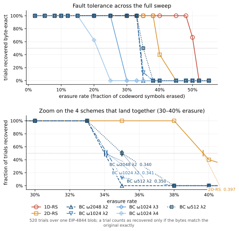
<figcaption>The table above, drawn. Every scheme holds at 100% and then falls off a cliff rather than degrading gradually &mdash; the transition from &ldquo;always recovers&rdquo; to &ldquo;never recovers&rdquo; spans a few percent of erasure rate, which is what makes a single threshold number a fair summary of each scheme. Each scheme carries its own marker and dash pattern as well as its own colour, because several curves coincide exactly and colour alone cannot separate them. <b>Right:</b> a zoom on the tightest band holding the most thresholds, with each crossing marked and labelled. That the three &lambda;=2 rows land within a hundredth of each other &mdash; 0.340, 0.341 and 0.350, across &mu; from 2 to 8 and &omega; from 512 to 2048 &mdash; is not a rendering problem to be worked around but the central result of the parameter sweep, and the zoom is there to let it be read rather than inferred. The dotted line at 50% is where these thresholds are defined.</figcaption>
</figure>

<figure>
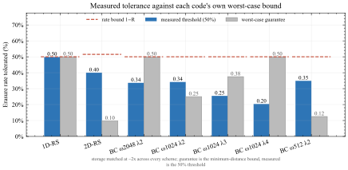
<figcaption>What each scheme actually tolerated (blue), beside its own minimum-distance guarantee (grey) and the rate bound 1&minus;<em>R</em> that no code of that rate can beat (dashed red). Storage is matched to within 3%, so the bars read against each other directly. 1D-RS lands on its bound &mdash; 0.51 measured against 0.50, inside one step of the sweep &mdash; which is what being MDS means. Three schemes sit <em>above</em> their own guarantee: 2D-RS at more than four times it, and both &lambda;=2 block-circulant rows with &mu;&gt;2. That is not a contradiction &mdash; a guarantee holds against every pattern including the adversarial worst case, while these trials draw patterns at random. Each blue bar is the erasure rate at which that scheme's success rate crosses 50%, linearly interpolated between the two swept rates that bracket the crossing (<code>_threshold</code> in <code>make_figures.py</code>).</figcaption>
</figure>

<figure>
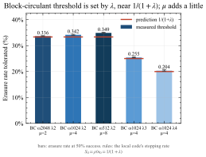
<figcaption>The block-circulant parameter sweep, and the clearest single result here. The decoder's reach is set by &lambda; alone: all three &lambda;=2 rows land together at 0.34&ndash;0.35 despite &mu; ranging over 2, 4, 8 and &omega; over 2048, 1024, 512 &mdash; a factor of four in block size that moves the threshold by nothing. Raising &lambda; to 3 drops it to 0.28, and to 4 drops it to 0.21. The red rules are the prediction S&#8320; = &rho;/N&#8320; = 1/(1+&lambda;), which is the local code's stopping rate in the source paper's own notation; the bars are what was measured, and the two agree at every point.</figcaption>
</figure>

<figure>
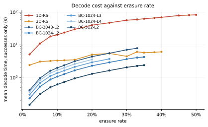
<figcaption>Mean decode time of the trials that actually recovered, against erasure rate, log scale. Failed trials are excluded: above its threshold a scheme rejects the pattern on a budget check in under a millisecond having attempted nothing, which is not a decode time. 1D-RS is the most expensive scheme at every rate, by a factor of three to five over the dearest block-circulant row, because it divides one 8192-length polynomial while the others divide short ones. Every block-circulant row is cheaper than 1D-RS at every rate measured. Against 2D-RS the picture is now mixed rather than one-sided: below about 8% erasure every BC row is cheaper, but 2D-RS decode barely grows with erasure rate while BC decode grows roughly linearly, so above that only &omega;512 &lambda;2 and &omega;1024 &lambda;4 stay below it. These are Vandermonde-path timings, with the NTT path switched off &mdash; see the NTT section for what turning it on costs, and for why defining the local code over roots of unity raises the block-circulant numbers here by roughly a factor of two whether or not the transform is ever used.</figcaption>
</figure>

<figure>
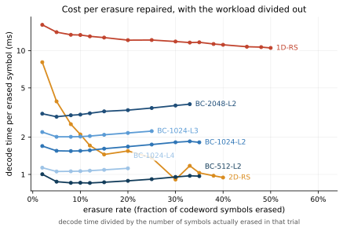
<figcaption>The same decode times with the workload divided out &mdash; cost per erasure actually repaired, rather than cost per decode. Raw decode time rises with erasure rate for every scheme, which mostly says there is more to fix; dividing by the erasure count removes that and leaves the algorithmic difference. 1D-RS sits flat near 10&ndash;13&nbsp;ms per erasure: its cost is essentially linear in the number of erasures, one long division's worth of work each. The block-circulant rows are three to ten times cheaper per erasure and rise gently, which is the short local divisions doing their job. 2D-RS is the interesting shape &mdash; it starts around 8&nbsp;ms and falls steeply toward 1&nbsp;ms, because its decode carries a large fixed cost that amortises as more cells need repairing. That is why it looks expensive at 2% erasure and cheap at 30%.</figcaption>
</figure>

<figure>
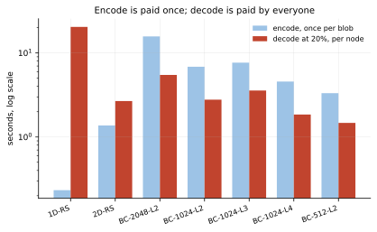
<figcaption>Encode and decode are not symmetric in a data-availability system and should not be collapsed into one cost. A blob is encoded <em>once</em>, by the proposer; it is decoded by every node that has to reconstruct it, so an expensive encode amortises across the network while an expensive decode does not. The two Reed-Solomon schemes and the block-circulant family sit on opposite sides of this: 1D-RS encodes in under a quarter of a second and then costs 20&nbsp;s to decode, while BC &omega;2048 &lambda;2 spends 16&nbsp;s encoding to decode in 5&nbsp;s. For PeerDAS the second shape is the more useful one, which is an argument for the block-circulant family that the tolerance numbers alone do not make.</figcaption>
</figure>

<figure>
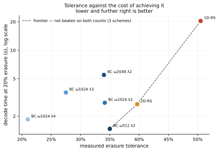
<figcaption>The trade-off the whole comparison is about, in one picture: how much erasure a scheme survives against what it costs to decode at a rate every scheme reached. Down and to the right is better. The dashed line is the Pareto frontier &mdash; the schemes not beaten on both counts at once &mdash; and only three schemes are on it. BC &omega;512 &lambda;2 is the cheapest thing that still tolerates a third of the codeword; 2D-RS buys about five more points of tolerance for roughly double the decode; 1D-RS buys the theoretical maximum and pays an order of magnitude for it. Everything else is dominated: some other scheme tolerates more erasure <em>and</em> decodes faster. Note especially that BC &omega;1024 &lambda;4 is dominated by BC &omega;512 &lambda;2 on both axes, so the tolerance it gives up buys nothing back.</figcaption>
</figure>

<figure>
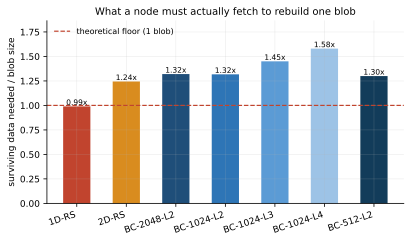
<figcaption>How much surviving data each scheme needs to rebuild one blob, as a multiple of the blob itself. This is the question that matters for data-availability sampling, where a node has to actually fetch those symbols. 1D-RS needs essentially the theoretical floor &mdash; no code rebuilds 124 KiB from less than 124 KiB. Every other scheme needs more, and a scheme tolerating a lower erasure rate at the same storage cost necessarily needs more.</figcaption>
</figure>

## What the results show

**1D-RS behaves exactly as Reed-Solomon theory says it must.** It
recovers everything up to 48% and nothing from 50% upward.
The invariant is exact rather than approximate: across every 1D-RS trial
in the sweep, recovery succeeded if and only if the drawn erasure count
was at most n&minus;k = 4096, with no exceptions. The partial results at the
threshold are not the decoder being unreliable — they are the random mask
landing on either side of a hard line. Being MDS, 1D-RS extracts
essentially all of its theoretical budget.

**2D-RS comes second, and beats its own guarantee by a wide margin.** It
holds to 35% and fails from 45%, with the transition straddling 38–40%
(5/5 at 38%, 2/5 at 40%, 0/5 at 45%) — call it 0.42. Two reference points
matter and they are very far apart. Its rate would permit 0.515; its
*minimum distance* only guarantees 0.098, because a product code's
distance is the product of its component distances, 33 × 25 = 825. The
measured 0.42 is more than four times that guarantee.

That gap is the cross-axis cascade doing real work. A guarantee has to
hold against the worst pattern in existence — for a product code, an
adversary who concentrates erasures to kill whole rows and columns at
once. Random patterns are nothing like that, so lines that are
individually over budget keep getting rescued once their partner axis
repairs enough neighbours. The honest summary is that 2D-RS's *typical*
behaviour is far better than its *guaranteed* behaviour, and which of the
two matters depends entirely on whether the erasures are adversarial.
Against the 1−*R* bound it reaches 82%; against its own distance it is at
430%.

**The Block-Circulant rows separate the code from the decoder, and λ is
what moves the decoder.** This is the clearest result in the sweep:

- **ω2048 λ2** (μ=2, MDS, *d*=4097): recovers to 33%, fails from 35%; predicted S₀ = 0.333.
- **ω1024 λ2** (μ=4, *d*=2049): recovers to 33%, fails from 38%; predicted S₀ = 0.333.
- **ω512 λ2** (μ=8, *d*=1025): recovers to 33%, fails from 38%; predicted S₀ = 0.333.
- **ω1024 λ3** (μ=4, *d*=3073): recovers to 25%, fails from 30%; predicted S₀ = 0.250.
- **ω1024 λ4** (μ=4, MDS, *d*=4097): recovers to 15%, fails from 25%; predicted S₀ = 0.200.

Two things fall out of that list. First, **the prediction is right every
time** — S₀ = ρ/N₀ = 1/(1+λ), the source paper's local stopping rate,
lands inside the measured transition band for all five rows. The limit is
not mysterious; it is arithmetic about how many erasures fit inside one
local support.

Second, **λ is the only parameter that moves it.** The three λ=2 rows all
land at 0.34–0.35 while μ ranges over 2, 4, 8 and ω over 2048, 1024, 512 —
a factor of four in block size that changes the threshold by nothing at
all. Raising λ to 3 costs 7 points, and to 4 costs 14. This is the direct
answer to "which knob should we turn": not ω, not μ, but λ, and downward.

Third, and most useful for the construction's prospects, **two of these
rows decode past their own worst-case guarantee.** ω1024 λ2 is guaranteed
only 0.250 and reaches 0.35; ω512 λ2 is guaranteed 0.125 and also reaches
0.35, nearly three times its bound. These are *not* MDS codes and cannot
claim to be; against a worst-case adversary they would fail where the
table says they fail. But under random erasure — which is what a sampling
network actually produces absent a targeted attack — they perform like
codes with far better distance. That is the sense in which parameters
that are "not fully decodable" still demonstrate the construction's
potential.

Set against that, every BC row is cheaper than 1D-RS at every rate
measured. Within the block-circulant family the ordering is now set as much
by the field as by λ: ω1024 λ4 decodes faster than either λ=2 row of the
same ω, not because λ=4 is a better choice but because its local length
5120 does not divide *p*&minus;1, so it never moved onto 255-bit evaluation
points and never paid for them. The NTT section below measures that cost.
The local system each solves is ρ×ρ, which generic elimination handles in
ρ³ — which is why the pairwise phase stays unaffordable while the
single-block phase does not, the latter's system being Vandermonde and so
dropping to ρ².

## Making these parameterisations runnable

The larger-ω BC rows could not be measured at all with the decoder as it
stood. The reason is worth recording, because it is the same wall anyone
re-running this will hit.

The original `gf_solve` is a Gauss-Jordan elimination written as a Python
loop over rows. Its cost grows as the cube of the matrix dimension, and
this field's arithmetic runs in `galois`' object mode at roughly 1.3
microseconds per element operation. At ω=ρ=2 the local systems are 2×2 and
none of that matters. At ω=ρ=1024 they are 1024×1024, which is about a
billion element operations — roughly 25 minutes for a single local solve,
with μ of them per decoding round.

Three changes brought it into range, none of which alters what is computed:

**The elimination step is now one broadcast update instead of a loop over
rows.** Same arithmetic, same element count, but the per-pivot dispatches
into object-mode arithmetic drop from *m* to one. Measured: 1.34 → 0.55
microseconds per element operation, a 2.4× speedup.

**The single-block solve now exploits the structure it always had.** The
local parity-check matrix is a GRS matrix, `H[r, c] = (c+1)^r`. Restricted
to the erased columns and to its first *e* rows it is a square Vandermonde
in distinct evaluation points — so it is always invertible, and it can be
solved in O(*e*²) by a node-polynomial argument rather than O(*e*³) by
elimination. Measured at *e* = 1024: 0.87 seconds against an extrapolated
1441, about 1650×. This is what makes ω=1024 tractable.

**The global parity-check matrix is no longer built.** It is
(μρ)×*n* = 4096×8192 = 33.5 million field elements, and every row the
decoder needs can be regenerated from (ρ, n₀) on demand.

A useful side effect: because the single-block system is provably square
Vandermonde in distinct nodes, it cannot be underdetermined, so the class
of bug described below cannot arise on that path at all.

## The pairwise phase does not get a turn

`DecCBC[2]`'s second phase stacks two adjacent blocks' parity checks and
solves them jointly. That system is *not* Vandermonde — the two row groups
assign different evaluation points to the same shared columns — so it
cannot use the fast solver and needs full elimination, at cubic cost.

Phase 2 only runs when phase 1 has stalled, which happens only once a
local support carries more than ρ erasures. Every row swept here has
ρ ≥ 256, so every pair that could possibly help carries more than 256
unknowns. The sweep applies a stated compute budget of 256 unknowns per
pairwise system, identically to all five rows, and above that budget a
pair is skipped, counted, and its positions left honestly flagged.

The consequence is that **all five rows are measured as single-phase
decoders**, and this is a limit of affordable computation rather than of
the code. The cost was measured directly on the 512-equation systems that
ω=ρ=256 produces:

| unknowns in the pair | erasure rate it corresponds to | per pair | per decoding round (16 pairs) |
|---|---|---|---|
| 276 | 6% | 21.7s | 5.8 min |
| 369 | 8% | 39.5s | 10.5 min |
| 461 | 10% | 61.7s | 16.4 min |

That is for the *smallest* local block swept here, and one decoding round is not
one decode — the loop repeats while it makes progress. At ω=ρ=1024 a full
pair is 2048 equations in 2048 unknowns; at the 0.57 microseconds per field
operation these timings imply, that is about 80 minutes for a single pair.
Lifting the cap enough to change any result would take days per sweep.

The honest reading of the BC numbers is therefore: this is what the
single-block phase of `DecCBC[2]` achieves. The pairwise phase would
roughly double the budget from ρ to 2ρ, which the same arithmetic puts at
0.333 for ω=1024, 0.200 for ω=512 and 0.111 for ω=256 — still short of
the 0.50 these codes permit.

## The Block-Circulant decoder fix

The BC results are from a corrected decoder. The version originally
benchmarked had two faults that together made its output untrustworthy
rather than merely weak. Both were found at the earlier ω=ρ=λ=2
parameterisation, and the before/after figure below is measured there.

**`gf_solve` fabricated values.** The Gaussian elimination routine returned
zero for any unknown whose column never received a pivot. To the caller
that is indistinguishable from having genuinely solved for zero, so an
underdetermined system silently produced a confident-looking wrong answer.
It now raises `GFSolveError` unless the system has exactly one solution —
every column pivoted, and no row reduced to `0 = nonzero`.

**`dec_cbc_2`'s pairwise phase accepted systems it had not solved.** Its
guard is `0 < erasures ≤ 2ρ`, which is necessary but not sufficient. The
equations it stacks are block *i*'s own ρ parity checks on top of block
*i+1*'s — not the auxiliary `[2(ω+ρ), 2ω, 2ρ+1]` GRS code over the union
of the two supports that the source paper's Algorithm 1 constructs. The
stacked form is not MDS, so a split such as "three erasures inside block
*i*'s support, one inside *i+1*'s" leaves two equations facing three
unknowns. Combined with the `gf_solve` fault, the decoder wrote zeros into
those positions *and cleared their erasure flags*, reporting success on
corrupted data. It now skips any pair it cannot uniquely solve, leaving
those positions honestly flagged.

The practical effect is stark. Measured before the fix, across 40 trials
spanning 5–45% erasure, `dec_cbc_2` claimed success **every single time**
and was wrong on 31 of them; it never once reported a failure. Its
`remaining` flag — the signal a caller would naturally trust — carried no
information about whether the data was correct. Had this benchmark trusted
that flag instead of checking bytes, it would have reported BC at 100%
success at every rate.

<figure>
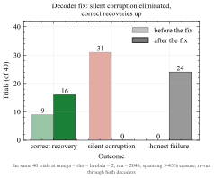
<figcaption>The decoder fix, measured on the parameterisation it was found at (&omega;=&rho;=&lambda;=2, &mu;=2048) &#8212; <em>not</em> the rows swept above. The same 40 trials (5%, 15%, 25% and 45% erasure, ten each) run through the decoder before and after. Correct recoveries rose from 9 to 16, because the old decoder poisoned positions with fabricated zeros that blocked later rounds from resolving them. Silent corruptions &#8212; cases where the decoder reported success on wrong data &#8212; fell from 31 to zero. The remaining failures are honest: the decoder reports the positions it could not resolve.</figcaption>
</figure>

A third change is a performance fix rather than a correctness one: the
pairwise phase used to `break` and restart the single-block phase after
every pair it repaired, paying a full scan of all local blocks per repair.
It now continues through the remaining pairs in the same pass.

**What none of this does** is restore the correction radius the paper
claims. Implementing the auxiliary GRS construction would let the pairwise
phase handle *any* ≤2ρ erasures across two adjacent blocks, rather than
only those solvable from the stacked parity checks — and, being a GRS code,
it would also be solvable in O(*e*²) rather than O(*e*³), which would
remove the compute wall described above. That is the single highest-value
piece of remaining work on this file.

### An implementation penalty the block-circulant rows carry

One caveat belongs with the decode times above, because it affects the
comparison between schemes rather than just their absolute values.

Making the block-circulant local code FFT-capable means defining it over
roots of unity, since that is what an NTT requires. But the evaluation points
*define the code* — the encoder uses the same ones — so the Vandermonde
solver ends up working over 255-bit field elements where the earlier version
used the small integers 1..n&#8320;. In pure-Python modular arithmetic operand
width is not free, and **this cost is paid whether or not the transform ever
runs**.

Measured across three versions of the decoder on the same machine, same
erasure patterns, min of three (2.33× median):

| variant (20% erasure) | small-integer points | roots of unity | penalty |
|---|---|---|---|
| BC ω2048 λ2 | 2.27s | 5.33s | 2.34× |
| BC ω1024 λ2 | 1.20s | 2.74s | 2.28× |
| BC ω1024 λ3 | 1.50s | 3.54s | 2.37× |
| BC ω512 λ2 | 0.66s | 1.43s | 2.15× |

The penalty falls **only on the block-circulant rows**. 1D-RS and 2D-RS are
untouched by it, and so is BC &omega;1024 &lambda;4, whose local length
5120 = 2<sup>10</sup>&middot;5 does not divide *p*&minus;1 and which therefore
never moved onto roots of unity.

Two consequences for reading the decode figures. The gap between 1D-RS and
the block-circulant family is **narrower than it would otherwise be** — about
three to five times rather than an order of magnitude. And the crossover with
2D-RS, which the decode-cost figure places near 8% erasure, would sit
substantially higher without the penalty. Neither changes any tolerance
result: success rates are identical across all three versions, verified cell
by cell.

This is a property of this implementation, not of block-circulant codes.
`decoder_version_benchmark.py` reproduces the measurement.

## The NTT decoder path

`BCcodeEthereum.py` carries a second decoder for the single-block phase,
built around a number-theoretic transform rather than the Vandermonde
solver described above. The motivation is sound: the source paper claims
O(*n* log² *n*) for this step, the local code is a GRS code, and a GRS
erasure decode is a transform, a pointwise multiply and a polynomial
division. On paper it should beat an O(*e*²) solve comfortably.

It does not, and the reasons are worth recording, because two of the three
are not about the transform at all.

### It was not running

The first finding is that the NTT path had never once executed to
completion. Every call ended in the same guard —

```
FFT failed (nonzero tail coefficients: input not a valid codeword)
```

— and fell through to the Vandermonde solver. The benchmark numbers were
therefore *Vandermonde numbers plus the cost of a failed NTT attempt*, and
the NTT rows looked slower for a reason that had nothing to do with the
transform.

The guard itself is correct and worth keeping. `fft_grs_erasure_decode`
inverse-transforms the locator-multiplied received word and requires the
coefficients above *k* + *e* to vanish; if they do not, the input is not a
codeword of the code it assumed, and returning a confident wrong answer
would be far worse than bailing out. The premise was what was wrong.

The local code is not a set of bare polynomial evaluations. `build_local_grs`
defines it by the parity check *H*[*r*, *c*] = *x*<sub>*c*</sub><sup>*r*</sup>,
which makes it a *generalised* Reed-Solomon code: its codewords are
*c*<sub>*j*</sub> = *v*<sub>*j*</sub> · *f*(*x*<sub>*j*</sub>) with column
multipliers *v*<sub>*j*</sub> = 1 / &prod;<sub>*i*&ne;*j*</sub>
(*x*<sub>*j*</sub> &minus; *x*<sub>*i*</sub>). For *n*&#8320;-th roots of
unity that product is *n*&#8320; / *x*<sub>*j*</sub>, so
*v*<sub>*j*</sub> is proportional to *x*<sub>*j*</sub>. The decoder was
handed codewords and treated them as evaluations, which they are not.

Dividing the received word through by *x*<sub>*c*</sub> before transforming,
and multiplying back afterwards, fixes it exactly — not approximately.

<figure>
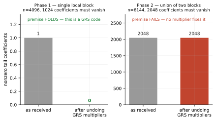
<figcaption>The premise the NTT decoder rests on, measured as the number of polynomial coefficients that are required to vanish and do not. <b>Phase 1</b> starts with a single stray coefficient and lands on exactly zero once the column multipliers are divided out &mdash; the local code really is GRS, and the fix is the right one. <b>Phase 2</b> is a different situation entirely: every one of its 2048 tail coefficients is nonzero, and stays nonzero after the same correction. No choice of multipliers repairs it, because the problem is not multipliers. Generated by <code>fft_benchmark.py</code>; the same two checks run as assertions in <code>test_bc_fft.py</code>, where the phase-2 case is asserted to <em>fail</em> so that the test turns red if the auxiliary construction is ever implemented.</figcaption>
</figure>

### Now that it runs, it is slower

With the multipliers applied the NTT path decodes correctly on every
FFT-eligible parameterisation. It is also between about seven and twenty-three
times slower than the solver it was meant to replace.

| variant | n&#8320; | NTT usable | 5% | 10% | 20% |
|---|---|---|---|---|---|
| BC ω2048 λ2 | 6144 | yes | 28.7s vs **1.3s** — 23× | 31.5s vs **2.5s** — 13× | 37.6s vs **5.6s** — 7× |
| BC ω1024 λ2 | 3072 | yes | 15.3s vs **0.7s** — 22× | 16.4s vs **1.3s** — 13× | 19.6s vs **2.8s** — 7× |
| BC ω1024 λ3 | 4096 | yes | 20.1s vs **0.9s** — 23× | 22.2s vs **1.7s** — 13× | 26.3s vs **3.6s** — 7× |
| BC ω512 λ2 | 1536 | yes | 7.9s vs **0.4s** — 21× | 8.6s vs **0.7s** — 12× | 10.1s vs **1.5s** — 7× |
| BC ω1024 λ4 | 5120 | no | **0.5s** (fallback only) | **0.9s** (fallback only) | **1.2s** (fallback only) |

Each cell is the NTT path against the Vandermonde fallback, mean of
3 trials, both decoding the same corrupted codeword in the same
process. **Bold is the faster path.** Phase 2 is held off throughout
(`use_fft_phase2=False`), so this isolates the single-block phase.

<figure>
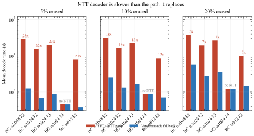
<figcaption>The same corrupted codeword decoded twice in the same process, once down each path, so machine speed and field-construction cost cancel. The NTT path loses everywhere it is available. It does scale better &mdash; across this rate range its cost grows by about a third while the Vandermonde solver's roughly quadruples &mdash; but extrapolating that trend to BC &omega;2048 &lambda;2's actual tolerance ceiling of 0.33 leaves it still roughly three to four times behind, so on this evidence the two never cross anywhere the decoder can actually operate. That last step is an extrapolation beyond the measured points and is offered as such. BC &omega;1024 &lambda;4 is marked <em>no NTT</em>: its local length is 5120 = 2<sup>10</sup>&middot;5, and the BLS12-381 scalar field has no element of order 5, so both bars are the same fallback.</figcaption>
</figure>

### The transform is not where the time goes

Profiling one local-block decode explains it. The NTT is a small minority
of the work; the dominant cost is the polynomial division that follows it.

<figure>
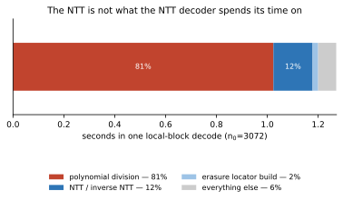
<figcaption>Where one local-block decode actually spends its time, measured by wrapping the three <code>galois</code> entry points the decoder calls rather than by bucketing a profiler dump &mdash; <code>cProfile</code> attributes the transform's work to a generic internal dispatcher, which makes the NTT look like it costs nothing at all. Roughly four fifths of the decode is a single <code>divmod</code> of two polynomials: <code>galois</code> implements that as a dense scalar loop, O(<em>n</em>&middot;<em>e</em>) field operations in Python, which for these sizes is close to a million big-integer multiplications. The function is, in effect, an NTT wrapper around a schoolbook division.</figcaption>
</figure>

This is a fixable problem, and the file's own docstring already names the
fix: *"Replacing the divmod with Newton iteration gives the paper's claimed
O(n log² n) bound."* Until that is done, the asymptotic argument for the NTT
path does not reach the code, because the step that dominates it is still
quadratic.

### Being FFT-capable is not free, even with the FFT switched off

The third cost is the least obvious and the most consequential for the
numbers in this report.

An NTT needs its evaluation points to be roots of unity. But the evaluation
points *define the code* — the encoder uses the same ones — so making the
local code FFT-capable means defining it over 255-bit field elements
instead of the small integers 1..*n*&#8320; the pre-NTT version used. The
Vandermonde fallback then has to solve over those same 255-bit values, and
in pure-Python modular arithmetic operand width is not free.

<figure>
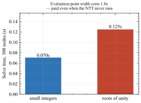
<figcaption><code>vandermonde_solve</code> given identical input on 300 nodes, differing only in how wide those nodes are. Small integers 1..300 are 9 bits; roots of unity in this field are 253&ndash;255 bits. The solver does the same number of operations either way &mdash; the gap is the cost of the operands themselves.</figcaption>
</figure>

Measured end to end against the pre-NTT decoder (commit `8d93ae3`), on the
same machine within the same hour, with the NTT path switched *off* so that
both versions run the same algorithm:

| variant | pre-NTT | current | |
|---|---|---|---|
| BC ω2048 λ2 @ 20% | 2.71s | 6.12s | 2.26× |
| BC ω1024 λ2 @ 20% | 1.44s | 3.13s | 2.17× |
| BC ω1024 λ3 @ 20% | 1.82s | 4.01s | 2.21× |
| BC ω512 λ2 @ 20% | 0.80s | 1.67s | 2.08× |
| **BC ω1024 λ4 @ 10%** | **1.04s** | **1.05s** | **1.01×** |

The slowdown tracks FFT-*eligibility* precisely. The one row that is
unchanged is the one row whose local length does not divide *p* &minus; 1,
so it never moved to roots of unity and never paid for them. The
microbenchmark above accounts for essentially all of the gap.

This particular table is the one measurement here that `fft_benchmark.py`
does not reproduce, because it needs both versions of the decoder present
at once. To repeat it, check the old file out beside the current one and
run the same decodes against each:

```
git worktree add /tmp/prefft 8d93ae3
```

### What this means for the parameterisations swept here

Three separate conclusions, which are easy to run together and should not
be:

**Phase 1's NTT path is correct but not yet worth using.** It needs the
Newton-iteration division before its asymptotics reach the measured cost.
Until then the Vandermonde solver is the faster path, and the switch
`use_fft_phase1` exists so that this is a decision rather than an accident.

**Phase 2's NTT path cannot work as written, and this is not a speed
question.** It relabels the union of two adjacent supports with a fresh set
of *n*<sub>aux</sub>-th roots of unity and decodes it as a flat GRS code.
The union is not one — as the section above on the pairwise phase already
notes, the two blocks' parity checks assign different evaluation points to
the columns they share, and relabelling discards exactly the structure that
would be needed. This is the same gap identified there: the paper's
Algorithm 1 auxiliary GRS construction is the missing piece, and it would
fix the correction radius and the cost together.

**Moving to roots of unity is a bet, not an improvement.** It costs a
factor of about 2.2 today and buys nothing until the division is fixed. It
is the right bet *if* the Newton iteration lands, because then the same
choice that costs 2.2× unlocks an O(*n* log² *n*) decoder. It is the wrong
one if the work stops here.

## Reproducing

```
pip install galois numpy matplotlib

python3 benchmark_1D_2D_BC.py     # the erasure sweep -> benchmark_results.json
python3 fft_benchmark.py          # the NTT measurements -> fft_results.json
python3 test_bc_fft.py            # structural checks on both decoder phases
python3 make_figures.py           # every figure -> docs/figures/
python3 make_docs.py              # every report -> docs/*.pdf
```

Per-trial results — erasure counts, decode times, success flags, and the
decoder's own claim separately from ground truth — are written to
`benchmark_results.json`. The NTT comparison, its profile breakdown, the
node-width microbenchmark and the phase-by-phase structural check go to
`fft_results.json`.

Both sweeps take a while: the erasure sweep is hours, and `fft_benchmark.py`
is 10–20 minutes because it deliberately runs the slow path it is measuring.
Neither is a prerequisite for the figures. `make_figures.py` reads the
committed JSON, so every figure in this report regenerates in a couple of
seconds without re-measuring anything.

That indirection is the point. These figures were previously hand-written
SVG, which meant a re-run could leave a chart quietly disagreeing with the
table printed beside it. Every figure here is now computed from the same
file the prose quotes, and the predictions drawn on them — the rate bound
1−R, the 1/(1+λ) local reach, the p⁴ and hypergeometric curves in the
network report — are calculated in the plotting code rather than
transcribed into it.
