# Figure catalogue

Every figure in `docs/report_figures/`, with what it asks, where the data comes from, how to read it and what it shows. Folders follow the order the report presents things.

Generated by `make_report_figures.py` from the same list that writes the figures, so the two cannot disagree. Each figure also exists as a 300 dpi PNG beside the SVG.

**18 figures** — 9 in `01-benchmark`, 8 in `02-network-sim`, 1 in `03-methodology`.

---

## The coding benchmark

*`01-benchmark/` — Seven schemes over the same blob, same erasure positions, at matched storage cost. This is the first results chapter.*

### 01. fault tolerance

<figure>
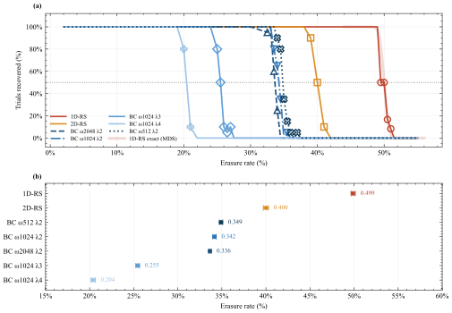
</figure>

**Goes in:** Results — fault tolerance

**The question.** How much of the codeword can each scheme lose and still rebuild the blob exactly?

**Where the data comes from.** The erasure sweep: 520 trials over one real EIP-4844 blob, 7 schemes x 18 erasure rates from 2% to 55%, fixed seed 20260827. benchmark_results.json.

**How to read it.** Top: fraction of trials recovered against erasure rate, one line per scheme, markers drawn only where a curve is partway down. Bottom: one row per scheme, the bar spanning the last rate where every trial recovered to the first where none did, with the 50% threshold ticked on it.

**What it shows.** Every scheme holds at 100% then collapses within a few percent, which is what makes a single threshold a fair summary. The three lambda=2 rows land at 0.340, 0.341 and 0.350 despite mu ranging 2 to 8 and omega 512 to 2048 - a factor of four in block size moving the threshold by nothing.

**Worth noting.** Erasures are drawn i.i.d., so these are upper bounds on performance against an adversary choosing the worst pattern.

<small>`01-benchmark/01-fault-tolerance.svg` and `.png` (300 dpi)</small>

### 02. fault tolerance compact

<figure>
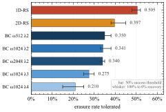
</figure>

**Goes in:** Results — fault tolerance (space-saving alternative to 01)

**The question.** Where does each scheme fall over, and how close together are those points?

**Where the data comes from.** The same erasure sweep as figure 01: 520 trials, 7 schemes, 18 rates. benchmark_results.json.

**How to read it.** One row per scheme, sorted by threshold. The bar spans the last rate at which every trial recovered to the first at which none did; the tick is the 50% threshold.

**What it shows.** The three lambda=2 rows cluster at 0.340, 0.341 and 0.350 across a factor of four in block size. The bar width also shows what a bare threshold hides: lambda=4 collapses over a much wider range of erasure rates than the lambda=2 rows do.

**Worth noting.** This is panel (b) of figure 01 on its own, at single-column width. Use it instead of 01 where space is tight: it carries the comparison, and the bar width preserves most of what the curves were there to show. Do not use both.

<small>`01-benchmark/02-fault-tolerance-compact.svg` and `.png` (300 dpi)</small>

### 03. bc threshold vs theory

<figure>
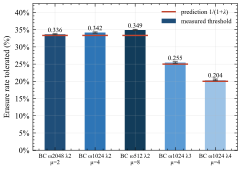
</figure>

**Goes in:** Results — fault tolerance

**The question.** Does the block-circulant decoder behave as the source paper predicts?

**Where the data comes from.** Same sweep. Thresholds derived from the success curves; the prediction is the local code's stopping rate from Sasidharan, Viterbo & Feist (ePrint 2026/708).

**How to read it.** Bars are measured thresholds, one per parameterisation, sorted by lambda. Red rules are the predicted stopping rate S0 = rho/n0 = 1/(1+lambda).

**What it shows.** Reach is set by lambda alone. Predicted 0.333/0.250/0.200 for lambda = 2/3/4 against measured 0.34/0.28/0.21. Theory and experiment agree at every point, and mu and omega do not enter.

<small>`01-benchmark/03-bc-threshold-vs-theory.svg` and `.png` (300 dpi)</small>

### 04. tolerance vs guarantee

<figure>
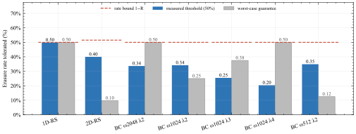
</figure>

**Goes in:** Discussion — guarantees versus behaviour

**The question.** How does what each code actually tolerated compare with what its minimum distance guarantees?

**Where the data comes from.** Same sweep for the measured bars; guarantees computed from each code's d_min, and the rate bound from 1 - R.

**How to read it.** Blue is the measured 50% threshold, grey the worst-case guarantee from minimum distance, dashed red the rate bound 1-R that no code of that rate can beat.

**What it shows.** 1D-RS sits on its bound (0.505 against 0.500), which is what being MDS means and a useful check that the harness is sound. 2D-RS reaches 0.397 against a guarantee of 0.098 - four times its own bound.

**Worth noting.** Not a contradiction. A minimum-distance guarantee holds against every pattern including the adversarial worst case; these trials draw patterns at random.

<small>`01-benchmark/04-tolerance-vs-guarantee.svg` and `.png` (300 dpi)</small>

### 05. decode cost

<figure>
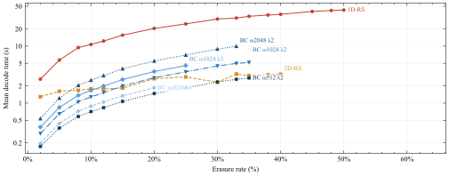
</figure>

**Goes in:** Results — computational cost

**The question.** What does each scheme cost to decode, and how does that grow with damage?

**Where the data comes from.** Same sweep. Mean over the trials that actually recovered; failed trials are excluded because a scheme above its threshold rejects the pattern on a budget check in under a millisecond, which is not a decode time.

**How to read it.** Log vertical axis in seconds, erasure rate horizontal, curves named at their right-hand ends.

**What it shows.** 1D-RS is the most expensive at every rate, three to five times the dearest block-circulant row, because it divides one 8192-length polynomial while the others divide short ones. Against 2D-RS the picture is mixed: below about 8% every BC row is cheaper, above it only the two smallest stay below.

**Worth noting.** Single-threaded Python over galois. Relative comparisons hold; absolute seconds would not survive an optimised build.

<small>`01-benchmark/05-decode-cost.svg` and `.png` (300 dpi)</small>

### 06. cost per erasure

<figure>
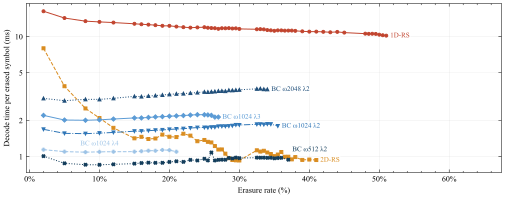
</figure>

**Goes in:** Discussion — why the costs differ

**The question.** Is one scheme dearer because it does more work per repair, or because it carries a fixed overhead?

**Where the data comes from.** The same decode times divided by the number of symbols actually erased in that trial.

**How to read it.** Milliseconds per erased symbol, log axis. A flat line means cost is linear in the number of erasures; a falling line means a fixed cost is being amortised over more repairs.

**What it shows.** 1D-RS is flat at 10-13 ms per erasure - one long division's worth of work each. The BC rows sit at 1-3.5 ms and rise gently. 2D-RS falls steeply from 8 ms to 1 ms, revealing a large fixed cost, which is exactly why it looks expensive at 2% erasure and cheap at 30%.

<small>`01-benchmark/06-cost-per-erasure.svg` and `.png` (300 dpi)</small>

### 07. encode vs decode

<figure>
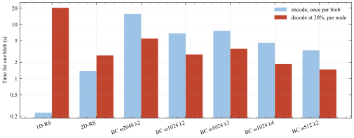
</figure>

**Goes in:** Discussion — asymmetry

**The question.** Encoding and decoding are not paid by the same party. How do the schemes differ on each?

**Where the data comes from.** Encode time measured once per scheme on the shared blob; decode at the highest rate every scheme still recovers.

**How to read it.** Paired bars per scheme, log axis in seconds.

**What it shows.** The two families sit on opposite sides of the asymmetry. 1D-RS encodes in 0.23 s then costs 20 s to decode; BC omega2048 lambda2 spends 15.7 s encoding in order to decode in 5.5 s.

**Worth noting.** A blob is encoded once by the proposer and decoded by every node reconstructing it, so an expensive encode amortises across the network and an expensive decode does not. For DAS the second shape is the useful one - an argument for block-circulant the tolerance numbers alone do not make.

<small>`01-benchmark/07-encode-vs-decode.svg` and `.png` (300 dpi)</small>

### 08. pareto tolerance vs cost

<figure>
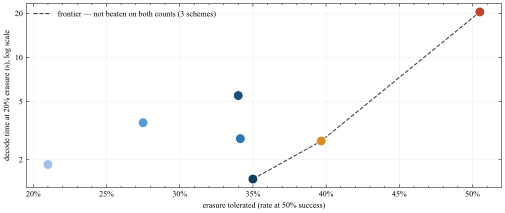
</figure>

**Goes in:** Discussion — the trade-off

**The question.** Which schemes are actually worth considering once tolerance and cost are weighed together?

**Where the data comes from.** Thresholds and decode times from the same sweep, at the highest rate every scheme reached.

**How to read it.** One point per scheme: tolerance horizontal, decode cost vertical on a log axis. Down and to the right is better. The dashed line is the Pareto frontier - schemes not beaten on both counts at once.

**What it shows.** Only three of seven are on the frontier. BC omega512 lambda2 is the cheapest thing still surviving a third of the codeword; 2D-RS buys about five more points of tolerance for roughly double the decode; 1D-RS buys the maximum and pays an order of magnitude. BC omega1024 lambda4 is dominated on both axes by omega512 lambda2, so the tolerance it gives up buys nothing.

**Worth noting.** If the report has one summary figure, this is it.

<small>`01-benchmark/08-pareto-tolerance-vs-cost.svg` and `.png` (300 dpi)</small>

### 09. data needed per blob

<figure>
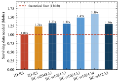
</figure>

**Goes in:** Results — bandwidth

**The question.** How much surviving data must a node obtain to rebuild one blob?

**Where the data comes from.** Derived from each scheme's measured threshold as n(1-threshold)/k, expressed as a multiple of one blob.

**How to read it.** Bars per scheme against a dashed line at 1.0, the theoretical floor - nothing rebuilds 124 KiB from less than 124 KiB.

**What it shows.** 1D-RS needs essentially the floor at 0.99x. Everything else needs 1.24x to 1.58x. A scheme tolerating a lower erasure rate at the same storage cost necessarily needs more.

**Worth noting.** Computed from code parameters. Network figure 04 measures the same quantity independently and agrees on the ordering.

<small>`01-benchmark/09-data-needed-per-blob.svg` and `.png` (300 dpi)</small>

## The network simulation

*`02-network-sim/` — The same schemes inside a simulated peer-to-peer network, where the erasure pattern is an output rather than an input. This follows the benchmark.*

### 01. erasure vs adversaries

<figure>
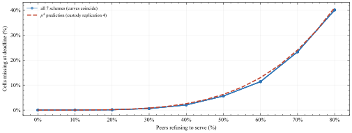
</figure>

**Goes in:** Results — network layer: fault tolerance

**The question.** When peers withhold data, what erasure rate does the code actually end up facing?

**Where the data comes from.** SimPy simulation, 64 peers, custody replication 4, one blob per slot at 50 Mbps, 4 s deadline, 30 trials per point, withholding swept 0 to 80%. docs/runA.json.

**How to read it.** Realised erasure against the fraction of peers refusing to serve, with the p^4 prediction dashed. All six schemes are drawn; they coincide.

**What it shows.** A cell is lost only if all four of its custodians withhold, so the erasure the code sees is roughly the fourth power of the bad-peer fraction: 50% of the network withholding yields about 5.6% erasure. Every scheme gives the identical curve, because this is a property of the network and custody, not the code.

**Worth noting.** Deflating for the coding schemes: replication absorbs most peer failure before the erasure code is asked to do anything.

<small>`02-network-sim/01-erasure-vs-adversaries.svg` and `.png` (300 dpi)</small>

### 02. recovery vs adversaries

<figure>
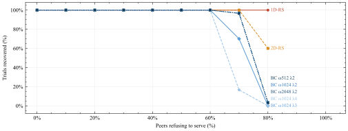
</figure>

**Goes in:** Results — network layer: fault tolerance

**The question.** Do the schemes fail in the same order when losses come from peer behaviour rather than an injected erasure rate?

**Where the data comes from.** Same run. No erasure rate is injected here - losses are whatever failed to arrive before the 4 s deadline.

**How to read it.** Fraction of 30 trials that rebuilt the blob byte-exactly, against withholding.

**What it shows.** They fail in exactly the order the coding benchmark predicted, and at the withholding rates that produce their measured thresholds. BC omega1024 lambda4 breaks first (8/30 at 70% withholding, which yields 0.233 erasure against its 0.210 threshold); 1D-RS is still at 30/30 when 80% of peers refuse.

**Worth noting.** This is the project's strongest evidence: two independent methods agreeing is far better than either alone.

<small>`02-network-sim/02-recovery-vs-adversaries.svg` and `.png` (300 dpi)</small>

### 03. latency gather time

<figure>
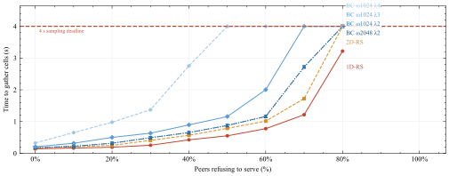
</figure>

**Goes in:** Results — network layer: latency

**The question.** Does withholding cost the victim anything beyond the data itself?

**Where the data comes from.** Same run. Gather time is network time only, excluding decode.

**How to read it.** Seconds to collect the cells, against withholding, with the 4 s sampling deadline marked. A curve reaching 4.00 has run out of time.

**What it shows.** Yes - it costs time. A peer that never answers cannot be routed around for free: the client burns its request timeout before falling back to another custodian. Gather climbs from 0.14 s to 3.22 s for 1D-RS across the sweep. The scheme needing the most cells hits the deadline first, omega1024 lambda4 at 50% withholding against 1D-RS at 80%.

**Worth noting.** Covers the brief's 'packet propagation latency'. Invisible in any figure measured only at zero adversaries.

<small>`02-network-sim/03-latency-gather-time.svg` and `.png` (300 dpi)</small>

### 04. bandwidth fetched

<figure>
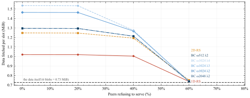
</figure>

**Goes in:** Results — network layer: bandwidth

**The question.** How much data does a node actually pull over the wire, as opposed to how much the code theoretically needs?

**Where the data comes from.** SimPy, 64 peers, replication 4, six blobs per slot at 25 Mbps - the bandwidth-pressure configuration. 30 trials per point. docs/runB.json.

**How to read it.** MiB fetched per slot against withholding, with a dashed line at the actual payload (six blobs = 0.73 MiB). Includes the over-request margin and anything re-requested after a timeout.

**What it shows.** 1D-RS pulls least at 1.04 MiB and BC omega1024 lambda4 most at 1.54 MiB - the same ordering benchmark figure 08 computes from code parameters, arrived at by completely independent means.

**Worth noting.** Read the fall at high withholding carefully: that is cells that never arrived, not a saving.

<small>`02-network-sim/04-bandwidth-fetched.svg` and `.png` (300 dpi)</small>

### 05. throughput blobs per slot

<figure>
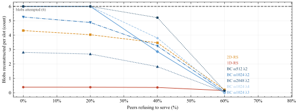
</figure>

**Goes in:** Results — network layer: throughput

**The question.** How many blobs can a node actually rebuild within one slot?

**Where the data comes from.** Same six-blob run. Throughput implied by the measured time - blobs attempted, scaled by recovery rate and by whether the total fits the slot - not an independently measured rate.

**How to read it.** Blobs reconstructed per slot out of six, against withholding, with a dashed line at six.

**What it shows.** The ordering inverts the tolerance ordering. 1D-RS tolerates the most erasure of any scheme and reconstructs the fewest blobs, about 0.2 of the six, because one 8192-length polynomial division costs roughly 59 s per blob. The three cheapest BC rows keep up with all six until 20% withholding.

**Worth noting.** Covers the brief's 'block processing throughput'.

<small>`02-network-sim/05-throughput-blobs-per-slot.svg` and `.png` (300 dpi)</small>

### 06. time budget vs slot

<figure>
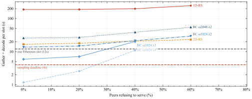
</figure>

**Goes in:** Discussion — can any of this keep up?

**The question.** Does the whole job - fetch plus rebuild - fit inside an Ethereum slot?

**Where the data comes from.** Same six-blob run. Gather plus decode summed per slot.

**How to read it.** Log seconds against withholding, with the 4 s sampling deadline and the 12 s slot both marked. Anything above the 12 s line cannot keep up with the chain.

**What it shows.** At zero adversaries only BC omega1024 lambda3 (6.4 s) and lambda4 (1.3 s) finish inside a slot. Past about 20% withholding nothing does. 1D-RS is not close at any setting - 354 s, roughly thirty slots of work for one slot of data.

**Worth noting.** The figure that reframes the comparison: erasure tolerance is not the binding constraint, decode throughput is.

<small>`02-network-sim/06-time-budget-vs-slot.svg` and `.png` (300 dpi)</small>

### 07. gather vs decode

<figure>
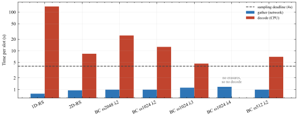
</figure>

**Goes in:** Discussion — the real bottleneck

**The question.** Of the time a node spends, how much is network and how much is arithmetic?

**Where the data comes from.** Same six-blob run, at zero adversaries so neither side is inflated by timeouts.

**How to read it.** Gather and decode as separate bars per scheme on a log axis - separate rather than stacked, because stacking on a log axis would misrepresent the sum. The slot deadline is marked.

**What it shows.** Every scheme gathers in about one second. Decode spans three orders of magnitude above that, from effectively zero to 354 s. At every setting tried, arithmetic rather than bandwidth or latency decides the outcome.

**Worth noting.** Bandwidth was the constraint this project expected to find binding. It is not close.

<small>`02-network-sim/07-gather-vs-decode.svg` and `.png` (300 dpi)</small>

### 08. scalability peer count

<figure>
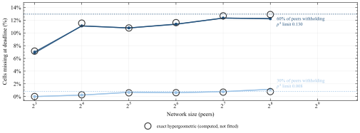
</figure>

**Goes in:** Results — network layer: scalability

**The question.** What happens to data availability as the network grows?

**Where the data comes from.** SimPy peer sweep, 8 to 256 peers, replication fixed at 4, one blob at 50 Mbps, 30 trials per point, at 30% and 60% withholding. docs/runC.json.

**How to read it.** Realised erasure against peer count on a log-2 axis. Open markers are the exact hypergeometric probability that all four custodians of a cell are adversarial, C(A,4)/C(n,4), computed from the model rather than fitted. Dotted lines are the p^4 independent-sampling limits.

**What it shows.** Growing the network makes things slightly worse, up to a limit. Custodians are drawn without replacement, so in a small network it is combinatorially hard for all four to be adversarial - with 8 peers only 5 are bad. As the network grows that constraint relaxes and loss climbs toward p^4 = 0.130. Measurement sits on the computed prediction throughout.

**Worth noting.** The lesson for scalability claims: what protects a cell is the fraction of the network custodying it, so peer count cannot be varied without saying what replication does too.

<small>`02-network-sim/08-scalability-peer-count.svg` and `.png` (300 dpi)</small>

## Methodology and validation

*`03-methodology/` — Referenced from the method chapter rather than the results.*

### 01. decoder correctness fix

<figure>
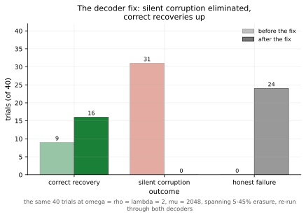
</figure>

**Goes in:** Methodology — validation

**The question.** Why does this project verify recovered bytes rather than trusting the decoder's own success flag?

**Where the data comes from.** A historical run at omega=rho=lambda=2, mu=2048 - a parameterisation the main sweep does not cover - with the same 40 trials (ten each at 5%, 15%, 25% and 45% erasure) put through the decoder before and after a correctness fix. decoder_fix_results.json.

**How to read it.** Outcome counts for the same 40 trials, before the fix in pale and after in solid. Three outcomes: correct recovery, silent corruption, honest failure.

**What it shows.** Before the fix the decoder claimed success on all 40 trials and was wrong on 31 of them; it never once reported a failure. After, silent corruption is zero and correct recoveries rose from 9 to 16 - the old decoder had been poisoning positions with fabricated zeros that blocked later rounds from resolving them.

**Worth noting.** Had the harness trusted the decoder's 'remaining' flag it would have reported 100% success at every erasure rate. The strongest validation argument the project has.

<small>`03-methodology/01-decoder-correctness-fix.svg` and `.png` (300 dpi)</small>
