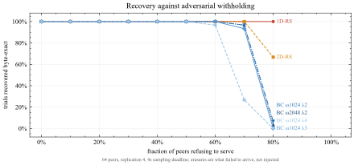
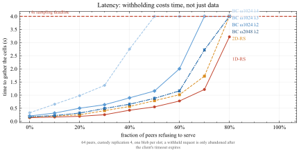
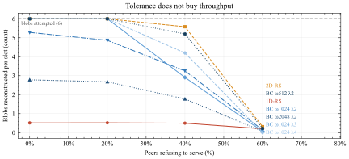
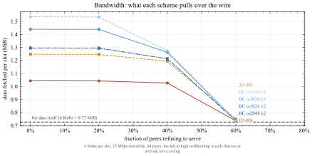
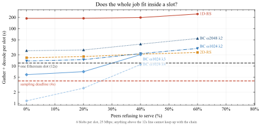
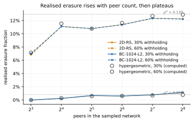

# The P2P network simulation

`network_sim.py` puts the coding schemes into a simulated peer-to-peer
network and measures what happens to them there. It is the Phase 3 half of
the project: where `benchmark_1D_2D_BC.py` asks *what can this code
survive*, this asks *can a node actually get the data and rebuild the blob
before the slot ends*.

Those are genuinely different questions, and the second one cannot be
answered by the first. A decode time of 40 seconds is a fact about
arithmetic. Whether 40 seconds is acceptable is a fact about a system with
a 12-second slot, a deadline, a finite link and peers that may not answer.

## What the project brief asks for, and where it now stands

Phase 3 of the proposal specifies prototypes "deployed within a controlled
simulated peer-to-peer (P2P) network environment", evaluated "across
standard network architectures", capturing "bandwidth saturation, packet
propagation latency, and block processing throughput" under "varying
adversarial blockchain network conditions".

| Requirement | Status |
|---|---|
| Simulated P2P environment | done — SimPy discrete-event, 64 peers, custody assignment |
| Packet propagation latency | done — per-peer lognormal latency, reported as gather time |
| Bandwidth saturation | done — one contended downlink; saturates under multi-blob load |
| Block processing throughput | done — blobs reconstructed per slot |
| Varying adversarial conditions | done — swept 0–80% withholding peers |
| Randomly generated blob data | done — real EIP-4844 packing, shared blob |
| Data reconstruction success rate | done — per-trial, byte-verified |
| Scalability in node count | done — peer count is a swept dimension |
| **Standard network architectures (plural)** | **not done — one topology only** |

The remaining gap is listed again at the end rather than buried. Everything
above it is measured.

## How SimPy works, in the three concepts this uses

SimPy is a discrete-event simulator. Nothing in it runs in real time.

**The environment is a clock and an event queue.** `env.now` is the current
*simulated* time in seconds. `env.run(until=4.0)` processes every scheduled
event up to simulated t=4s and stops.

**A process is an ordinary Python generator.** `yield env.timeout(0.08)`
means "resume me 80 simulated milliseconds from now". The scheduler jumps
straight to the next event rather than waiting, so simulating a 12-second
slot across 64 peers costs microseconds of real CPU. This is what makes
sweeping hundreds of network configurations cheap.

**A resource models contention.** The node's downlink is a
`simpy.Resource` of capacity 1: a transfer acquires it, holds it for
`bytes / bandwidth` seconds, releases it. Because every transfer queues for
the same object, bandwidth saturation *emerges* from demand rather than
being asserted — ask for more than the link can carry before the deadline
and the queue backs up until the stragglers miss it.

## The one idea the design rests on

In the coding benchmark, the erasure mask is an **input**: `random_mask(rate,
rng)` invents one at a nominal rate. Here it is an **output** — whatever the
node failed to collect in time.

```
benchmark:    mask = adapter.random_mask(rate, rng)     # invented
network sim:  mask = <what did not arrive before the deadline>
```

Everything downstream of the mask — decode, extraction, byte-level
verification — is the *same adapter code* the benchmark already uses,
untouched. That single substitution is the entire integration surface,
which is why this file contains no coding logic of its own. A fix to
`2D_RS_Galois.py` changes these results automatically.

This buys something beyond convenience. The benchmark drops symbols
independently; real failures are not independent, because when a peer goes
offline *everything it custodied* vanishes at once. A peer-failure model
produces those **clustered** erasures for free, from the topology, rather
than having to inject correlation by hand — and the benchmark report
explicitly flags i.i.d.-only testing as a limitation.

## What is modelled

**Peers and custody.** 64 peers. Each cell is held by `custody_replication`
of them (default 4), so a cell is lost only if every custodian fails. This
is the *network's* redundancy, and it is separate from the code's — an
important distinction, because it turns out to absorb most peer failure
before the erasure code is asked to do anything.

**Cells.** The unit a node requests is a PeerDAS-shaped cell: 64 field
elements × 32 bytes, plus a 48-byte KZG proof, so 2096 bytes.

**Adversaries.** A fraction of peers never answer. The client burns its
request timeout before falling back to another custodian, so withholding
costs the victim *time* as well as data — which is the point of modelling
it rather than just deleting symbols.

**The deadline.** A 4-second sampling window inside a 12-second slot.
Anything not received by then is an erasure, full stop.

### How much a node actually has to download

This is the part worth dwelling on, because getting it wrong produced
nonsense on the first attempt.

The obvious answer is *k* symbols — the information-theoretic floor. That
is right only for an MDS code decoded optimally. In general a node must
fetch enough that what remains *missing* falls inside its own decoder's
tolerance:

> symbols needed = *n* × (1 − tolerance)

| | tolerance used | must fetch | of |
|---|---|---|---|
| 1D-RS | 0.49 | 4178 | 8192 |
| 2D-RS | 0.38 | 5238 | 8448 |
| BC ω1024 λ2 | 0.33 | 5489 | 8192 |

The tolerance here is deliberately **conservative**: the highest swept rate
at which *every* trial recovered, not the 50% threshold the benchmark
report quotes. A node sizing its download wants to recover reliably, not
half the time, so it plans against the point where recovery is certain.
That is why these sit below the thresholds of 0.499, 0.400 and 0.342 — the
two are different quantities answering different questions, and both are
correct. For 1D-RS the rule asks for 2% more than the 4096 symbols an MDS
code strictly needs, because it is applied the same way to every scheme,
from measured behaviour rather than from each code's structure.

So a weaker decoder forces a **larger download at identical storage cost**.
This is the benchmark report's "surviving data needed" figure, no longer
sitting in a table but actually driving a network transfer. Setting the
fetch target from *k* alone instead made every scheme sit at 42% erasure
even with a perfect network, and BC then "failed" at zero adversaries —
an artifact of the fetch policy, not a property of the code.

## Results

The figures below come from three sweeps, all with 30 trials per point:
**A** — one blob at 50 Mbps, six schemes, withholding swept 0–80%;
**B** — six blobs at 25 Mbps, the same schemes, 0–60%;
**C** — peer count 8→256 at 30% and 60% withholding. Raw rows are in the
accompanying JSON.

Decode times come from this project's Python/`galois` implementation and
are, by a rough estimate rather than a measurement, two to three orders of
magnitude slower than production field arithmetic. Absolute figures describe *this code*; comparisons between
schemes are the transferable part. `--speedup N` divides decode by N to ask
what production arithmetic would look like.

<figure>

<figcaption><b>Custody replication, not the code, is what absorbs peer failure.</b> A cell is lost only when every one of its four custodians withholds, so the erasure the code actually sees is roughly the fourth power of the fraction of bad peers. The dashed line is that p⁴ prediction, computed from the model and not fitted; the solid line is what 30 trials per point produced. From 20% withholding up, measurement sits slightly below the line, because the network is finite: exactly round(64<em>p</em>) peers withhold and custodians are drawn without replacement, so the chance that all four are bad is the hypergeometric C(<em>A</em>,4)/C(64,4), a little under <em>p</em>⁴ &mdash; the peer-count figure below shows that effect directly. At 10% both are effectively zero. The practical reading: 40% of peers withholding costs about 2% of the data.</figcaption>
</figure>

<figure>

<figcaption><b>What each scheme's erasure threshold means in terms of withholding peers.</b> No erasure rate is injected here — losses come from peers refusing to answer, and custody replication turns the fraction of withholding peers into a realised erasure fraction. Whether that erasure is survivable is then read from the coding benchmark's measured recovery curve (the simulation is calibrated, not re-decoding), so the order in which the schemes fail is the benchmark's order by construction; what the figure adds is the withholding level at which each one breaks. BC ω1024 λ4 breaks first: 70% withholding yields 0.233 erasure, above its 0.204 threshold, and it recovers 5 of 30, with ω1024 λ3 close behind at 21 of 30. 2D-RS and the λ2 rows hold until 80% withholding drives erasure to 0.400; 1D-RS, at 0.499, recovers every trial in the sweep. 30 trials per point.</figcaption>
</figure>

<figure>

<figcaption><b>Withholding costs the victim time, not only data.</b> A peer that never answers is not free to route around: the client has to burn its request timeout before it can fall back to another custodian, so gather time climbs with the adversarial fraction even at rates where every cell is eventually retrieved. This is the propagation-latency axis the brief asks for, and it is invisible in any figure measured only at zero adversaries. The schemes separate by how many cells they need: BC &omega;1024 &lambda;4 tolerates the least erasure, so it must fetch the most, so it is the first to hit the four-second deadline &mdash; at 60% withholding &mdash; while 1D-RS, needing the fewest cells, never reaches it in this sweep (2.8&nbsp;s at 80%).</figcaption>
</figure>

### One blob per slot, 50 Mbps (selected rates; full sweep in runA.json)

| scheme | adversarial | recovered | erasure | KiB | gather | decode | total | blobs/slot |
|---|---|---|---|---|---|---|---|---|
| 1D-RS | 0% | 30/30 | 0.000 | 262 | 0.14s | 0.00s | 0.14s | 1.00 |
| 1D-RS | 20% | 30/30 | 0.001 | 262 | 0.19s | 0.44s | 0.63s | 1.00 |
| 1D-RS | 40% | 30/30 | 0.021 | 257 | 0.41s | 3.07s | 3.48s | 1.00 |
| 1D-RS | 60% | 30/30 | 0.114 | 232 | 0.74s | 12.38s | 13.12s | 0.91 |
| 1D-RS | 70% | 30/30 | 0.233 | 201 | 1.17s | 22.87s | 24.04s | 0.50 |
| 1D-RS | 80% | 30/30 | 0.400 | 157 | 2.76s | 36.14s | 38.90s | 0.31 |
| 2D-RS | 0% | 30/30 | 0.000 | 270 | 0.17s | 0.00s | 0.17s | 1.00 |
| 2D-RS | 20% | 30/30 | 0.001 | 270 | 0.25s | 0.21s | 0.46s | 1.00 |
| 2D-RS | 40% | 30/30 | 0.021 | 265 | 0.57s | 1.28s | 1.85s | 1.00 |
| 2D-RS | 60% | 30/30 | 0.114 | 239 | 1.02s | 1.76s | 2.78s | 1.00 |
| 2D-RS | 70% | 30/30 | 0.234 | 207 | 1.72s | 2.74s | 4.47s | 1.00 |
| 2D-RS | 80% | 18/30 | 0.400 | 162 | 4.00s | 3.15s | 7.15s | 0.60 |
| BC ω2048 λ2 | 0% | 30/30 | 0.000 | 262 | 0.18s | 0.00s | 0.18s | 1.00 |
| BC ω2048 λ2 | 20% | 30/30 | 0.001 | 262 | 0.32s | 0.09s | 0.40s | 1.00 |
| BC ω2048 λ2 | 40% | 30/30 | 0.021 | 257 | 0.65s | 0.61s | 1.26s | 1.00 |
| BC ω2048 λ2 | 60% | 30/30 | 0.114 | 232 | 1.16s | 2.91s | 4.07s | 1.00 |
| BC ω2048 λ2 | 70% | 29/30 | 0.233 | 201 | 2.72s | 6.34s | 9.02s | 0.97 |
| BC ω2048 λ2 | 80% | 1/30 | 0.400 | 157 | 4.00s | 9.87s | 13.87s | 0.03 |
| BC ω1024 λ2 | 0% | 30/30 | 0.000 | 262 | 0.18s | 0.00s | 0.18s | 1.00 |
| BC ω1024 λ2 | 20% | 30/30 | 0.001 | 262 | 0.32s | 0.05s | 0.36s | 1.00 |
| BC ω1024 λ2 | 40% | 30/30 | 0.021 | 257 | 0.65s | 0.33s | 0.99s | 1.00 |
| BC ω1024 λ2 | 60% | 30/30 | 0.114 | 232 | 1.16s | 1.51s | 2.67s | 1.00 |
| BC ω1024 λ2 | 70% | 29/30 | 0.233 | 201 | 2.72s | 3.23s | 5.90s | 0.97 |
| BC ω1024 λ2 | 80% | 1/30 | 0.400 | 157 | 4.00s | 4.98s | 8.98s | 0.03 |
| BC ω1024 λ3 | 0% | 30/30 | 0.000 | 262 | 0.21s | 0.00s | 0.21s | 1.00 |
| BC ω1024 λ3 | 20% | 30/30 | 0.001 | 262 | 0.52s | 0.06s | 0.59s | 1.00 |
| BC ω1024 λ3 | 40% | 30/30 | 0.021 | 257 | 0.94s | 0.43s | 1.38s | 1.00 |
| BC ω1024 λ3 | 60% | 30/30 | 0.114 | 232 | 2.43s | 1.95s | 4.38s | 1.00 |
| BC ω1024 λ3 | 70% | 21/30 | 0.233 | 201 | 4.00s | 3.87s | 7.87s | 0.70 |
| BC ω1024 λ3 | 80% | 0/30 | 0.400 | 157 | 4.00s | &mdash; | &mdash; | 0.00 |
| BC ω1024 λ4 | 0% | 30/30 | 0.000 | 262 | 0.24s | 0.00s | 0.24s | 1.00 |
| BC ω1024 λ4 | 20% | 30/30 | 0.001 | 262 | 0.63s | 0.03s | 0.66s | 1.00 |
| BC ω1024 λ4 | 40% | 30/30 | 0.021 | 257 | 1.19s | 0.23s | 1.42s | 1.00 |
| BC ω1024 λ4 | 60% | 30/30 | 0.114 | 232 | 4.00s | 1.04s | 5.04s | 1.00 |
| BC ω1024 λ4 | 70% | 5/30 | 0.233 | 201 | 4.00s | 1.78s | 5.78s | 0.17 |
| BC ω1024 λ4 | 80% | 0/30 | 0.400 | 157 | 4.00s | &mdash; | &mdash; | 0.00 |

### Six blobs per slot, 25 Mbps — where bandwidth starts to bite

| scheme | adversarial | recovered | erasure | KiB | gather | decode | total | blobs/slot |
|---|---|---|---|---|---|---|---|---|
| 1D-RS | 0% | 30/30 | 0.336 | 1044 | 0.78s | 185.90s | 186.68s | 0.39 |
| 1D-RS | 20% | 30/30 | 0.336 | 1043 | 1.59s | 186.49s | 188.07s | 0.38 |
| 1D-RS | 40% | 30/30 | 0.348 | 1028 | 3.14s | 194.07s | 197.21s | 0.37 |
| 1D-RS | 60% | 15/30 | 0.514 | 753 | 4.00s | 240.94s | 244.94s | 0.15 |
| 2D-RS | 0% | 30/30 | 0.212 | 1277 | 0.95s | 15.71s | 16.66s | 4.32 |
| 2D-RS | 20% | 30/30 | 0.213 | 1276 | 1.98s | 15.87s | 17.86s | 4.03 |
| 2D-RS | 40% | 30/30 | 0.248 | 1222 | 3.72s | 17.01s | 20.73s | 3.47 |
| 2D-RS | 60% | 2/30 | 0.517 | 769 | 4.00s | 18.99s | 22.99s | 0.21 |
| BC ω2048 λ2 | 0% | 30/30 | 0.156 | 1326 | 0.99s | 24.67s | 25.66s | 2.81 |
| BC ω2048 λ2 | 20% | 30/30 | 0.157 | 1325 | 2.03s | 24.74s | 26.77s | 2.69 |
| BC ω2048 λ2 | 40% | 29/30 | 0.214 | 1242 | 3.79s | 34.59s | 38.37s | 1.81 |
| BC ω2048 λ2 | 60% | 1/30 | 0.511 | 756 | 4.00s | 50.36s | 54.36s | 0.04 |
| BC ω1024 λ2 | 0% | 30/30 | 0.156 | 1326 | 0.99s | 12.68s | 13.67s | 5.27 |
| BC ω1024 λ2 | 20% | 30/30 | 0.157 | 1325 | 2.03s | 12.72s | 14.75s | 4.88 |
| BC ω1024 λ2 | 40% | 29/30 | 0.214 | 1242 | 3.79s | 17.65s | 21.43s | 3.25 |
| BC ω1024 λ2 | 60% | 1/30 | 0.511 | 756 | 4.00s | 25.47s | 29.47s | 0.08 |
| BC ω1024 λ3 | 0% | 30/30 | 0.047 | 1498 | 1.11s | 4.76s | 5.88s | 6.00 |
| BC ω1024 λ3 | 20% | 30/30 | 0.047 | 1497 | 2.26s | 4.81s | 7.07s | 6.00 |
| BC ω1024 λ3 | 40% | 24/30 | 0.183 | 1297 | 3.94s | 16.24s | 20.17s | 2.86 |
| BC ω1024 λ3 | 60% | 0/30 | 0.511 | 756 | 4.00s | &mdash; | &mdash; | 0.00 |
| BC ω1024 λ4 | 0% | 30/30 | 0.000 | 1572 | 1.17s | 0.00s | 1.17s | 6.00 |
| BC ω1024 λ4 | 20% | 30/30 | 0.001 | 1570 | 2.37s | 0.19s | 2.56s | 6.00 |
| BC ω1024 λ4 | 40% | 19/30 | 0.179 | 1304 | 3.97s | 6.98s | 10.93s | 3.80 |
| BC ω1024 λ4 | 60% | 0/30 | 0.511 | 756 | 4.00s | &mdash; | &mdash; | 0.00 |

<figure>

<figcaption><b>Throughput at six blobs per slot and 25 Mbps — the ordering broadly inverts.</b> 1D-RS tolerates the most erasure of any scheme here and reconstructs the fewest blobs, about 0.4 of the six, because one 8192-length polynomial division costs about 31&nbsp;s per blob. BC ω1024 λ3 and λ4 keep up with all six until 20% withholding; at zero withholding ω1024 λ2 manages 5.3, 2D-RS 4.3 and ω2048 λ2 2.8. The inversion is not strict: ω2048 λ2's large blocks make it slower to decode than both 2D-RS and ω1024 λ2. Note this is throughput <em>implied by</em> the measured time — blobs attempted, scaled by the measured recovery rate and by the share of the work that fits in the 12s slot — not an independently measured rate.</figcaption>
</figure>

<figure>

<figcaption><b>Where the time goes, six blobs, no adversaries, log scale.</b> Gather and decode are drawn as separate bars rather than stacked, because stacking on a log axis would misrepresent the sum. Every scheme gathers in about one second; decode runs from about 5&nbsp;s to 186&nbsp;s above that. This is the central result of the network layer: apart from the one scheme that avoids decoding altogether, arithmetic rather than bandwidth or latency decides whether a scheme fits the slot. BC ω1024 λ4 is that exception, and it shows no decode bar because it has the weakest decoder: it needs 81% of the codeword, and with the over-request margin and the requests already in flight it ends up holding all of it, so there is nothing to reconstruct. It buys its speed with bandwidth.</figcaption>
</figure>

<figure>

<figcaption><b>The bandwidth a node actually pulls.</b> The download target is set from each scheme's measured tolerance &mdash; the same quantity behind the coding benchmark's surviving-data figure &mdash; so the ordering here follows that figure by construction. What the simulation adds is the real cost on top: the over-request margin, requests already in flight when the target is met, and anything re-requested after a timeout. 1D-RS fetches least (1.02&nbsp;MiB for six blobs, against 0.73&nbsp;MiB of actual payload) and BC &omega;1024 &lambda;4 most, at 1.54&nbsp;MiB, the whole codeword. Read the fall at high withholding carefully &mdash; it is cells that never arrived, not a saving.</figcaption>
</figure>

<figure>

<figcaption><b>The question the whole network layer exists to answer.</b> A scheme is only usable if gather plus decode finishes inside an Ethereum slot. At six blobs and zero adversaries only BC &omega;1024 &lambda;3 (5.9&nbsp;s) and &lambda;4 (1.2&nbsp;s) are under twelve seconds, with &omega;1024 &lambda;2 just over at 13.7&nbsp;s; by 40% withholding only &lambda;4 still averages under twelve seconds, and it recovers in only 19 of 30 trials. 1D-RS is not close at any setting &mdash; 187&nbsp;s at zero adversaries, roughly fifteen slots' worth of work for one slot's data. This is the figure that reframes the comparison: erasure tolerance is not the binding constraint, decode throughput is.</figcaption>
</figure>

<figure>

<figcaption><b>Growing the network makes things slightly worse, up to a limit.</b> At 60% withholding and fixed replication 4, custodians are drawn without replacement, so in a small network it is combinatorially hard for all four custodians of a cell to be adversarial — with 8 peers only 5 are bad and there are few ways to choose 4 of them. As the network grows this constraint relaxes and the loss rate climbs toward the independent-sampling limit p⁴ = 0.130. The open markers are the exact hypergeometric probability, again computed rather than fitted; both schemes sit on it. The lesson for scalability claims is that what protects a cell is the <em>fraction</em> of the network custodying it, so peer count cannot be varied without saying what replication does too.</figcaption>
</figure>

## What the results show

**Decode dominates; the network barely registers.** Gathering takes
between 0.14 seconds and the 4-second deadline. Decoding takes up to 241.
At every parameter setting tried, except where a scheme avoids decoding
altogether, the bottleneck is arithmetic, not the link or the latency.
Cutting bandwidth fivefold, from 25 Mbps to 5 Mbps, moved 2D-RS's six-blob
total from 16.7s to 17.7s — a 6% change, because the extra second of
transfer disappeared next to 16 seconds of decode (a separate 30-trial run
at zero withholding, `--schemes 2D-RS --blobs 6 --downlink 5`). At six
blobs the spread is starker still: every scheme gathers in about one
second, while decode ranges from 0.0s to 185.9s.

That single finding reframes the comparison. The coding benchmark reported
decode cost as one column among several; placed in a slot budget it becomes
the only column that decides anything.

**1D-RS tolerates the most and delivers the least.** At 80% of peers
withholding — a realised erasure fraction of 0.400 — it is the only scheme
still recovering every trial, 30/30, where 2D-RS manages 18/30 and the
block-circulant rows collapse to 1/30 or worse. It needed 38.9 seconds to
do it, more than three times the slot. At six blobs it reconstructs 0.39 of
them per slot. Best fault tolerance in the study, worst throughput, and the
two facts have the same cause: one enormous polynomial division.

**Two block-circulant rows keep up with six blobs; nothing else does.**
BC ω1024 λ3 and λ4 reconstruct all six, against ω1024 λ2's 5.27, 2D-RS's
4.32, BC ω2048 λ2's 2.81 and 1D-RS's 0.39. Their decoders are among the
weakest in the study — λ3 tolerates 0.255 where 1D-RS tolerates 0.499 —
but λ3 decodes roughly 39× faster (4.8s against 185.9s for the same six
blobs), and inside a deadline that trade is strongly favourable. ω1024 λ2,
decoding 15× faster than 1D-RS, misses the slot by under two seconds.

There is a visible progression inside the three ω1024 rows, and it is a
bandwidth-for-compute trade. λ2 fetches 1326 KiB and decodes for 12.7s;
λ3 fetches 1498 KiB and decodes for 4.8s; λ4 fetches 1572 KiB and decodes
for 0.0s, because its tolerance is so low that it must fetch essentially the
whole codeword and then has nothing left to reconstruct. The weakest decoder
ends up doing no decoding at all — by paying for it on the wire.

**Network-level custody replication absorbs most peer failure before the
code is involved.** At 70% adversarial peers the realised erasure fraction
is only 0.233, because a cell dies only when all four of its custodians do.
The erasure code's tolerance is not the binding constraint until the
adversarial fraction is very high — which suggests custody replication and
code strength are substitutes, and that the cheaper one should be bought
first.

**More peers is not automatically safer, and can be worse.** Sweeping peer
count at fixed custody replication produced a result worth stating because
it runs against intuition. Custodians are drawn without replacement, so in a
small network it is combinatorially hard for all four custodians of a cell to
be adversarial: with 8 peers and 60% withholding only 5 peers are bad, and
there are just 5 ways to choose 4 of them out of 70. As the network grows
that constraint relaxes and the loss rate climbs toward the
independent-sampling limit p⁴. Measured erasure at 60% withholding runs
0.068 at 8 peers, 0.111 at 16, 0.114 at 64 and 0.123 at 256, against the
exact hypergeometric values 0.071, 0.115, 0.116 and 0.129 — agreement within
0.007 at every point. At 30% withholding 2D-RS took 0.33s with 8 peers and
1.10s with 64, entirely because the larger network lost more cells and
therefore had more to decode.

The lesson is that what protects a cell is not the peer count but the
*fraction of the network custodying it*. Growing the network while holding
replication fixed quietly dilutes that fraction. Any scalability claim about
node count has to say what happens to replication at the same time, or it is
not saying anything.

**A weaker decoder costs bandwidth as well as tolerance.** BC fetched
1326 KiB where 1D-RS fetched 1044 KiB for the same six blobs, because it
needs a larger surviving fraction to decode at all. At equal storage, the
scheme with the weaker decoder pays on the wire too — a cost the isolated
coding benchmark could not show.

## Validation, and two bugs it caught

The calibrated decode-cost model was checked against `--real-decode`, which
hands the emergent clustered mask to the actual decoders. Both modes ran
with run A's network (64 peers, one blob, 50 Mbps, replication 4) and the
same seed, so the network realisation — and the erasure each trial saw — is
identical, and only the decoder differs. Five trials per point:

```
python3 network_sim.py --schemes 2D-RS,BC-1024-L2 --adversarial 0.4,0.6 --trials 5
python3 network_sim.py --schemes 2D-RS,BC-1024-L2 --adversarial 0.4,0.6 --trials 5 --real-decode
```

| point | calibrated | real |
|---|---|---|
| 2D-RS @ 40% adversarial | 1.03s | 0.67s |
| 2D-RS @ 60% | 1.72s | 1.26s |
| BC ω1024 λ2 @ 40% | 0.23s | 0.13s |
| BC ω1024 λ2 @ 60% | 1.29s | 1.31s |

Same order of magnitude, real equal or faster, and every trial recovered —
so clustered erasures at these levels decode as cleanly as i.i.d. ones.
These points sit at 1–10% realised erasure, far below every threshold, so
they check decode *cost* under clustering, not where schemes fail; near a
threshold, recovery under clustered erasure is still taken from the i.i.d.
calibration.

Two errors surfaced this way and are fixed:

1. **Zero-erasure rounds invented work.** The cost curve was held flat at
   its lowest *measured* rate (0.02), so a round with nothing missing was
   charged several seconds of decoding. `--real-decode` reported 0.00s and
   exposed it.
2. **Gather time was reporting the deadline back.** The first version ran
   the environment to the deadline and reported `env.now`, which is the
   deadline by construction. It now records the moment the node actually
   held enough cells to start decoding.

## Limitations

**One topology.** The brief asks for "standard network architectures",
plural. This models a flat network with uniform random custody. Structured
overlays, clustered or geographically correlated latency, and churn are not
represented. This is the largest remaining gap.

**One-hop fetches only.** A node requests cells directly from custodians.
There is no gossip propagation, no forwarding, no upload-side cost — so
this measures a node's *download* experience, not network-wide load.

**Decode cost is Python-speed.** Stated above and worth restating: absolute
timings are, by rough estimate, two to three orders of magnitude off production, which is what
`--speedup` exists for. Relative comparisons hold.

**Recovery is calibrated, not re-decoded.** In the default mode, whether a
scheme recovers at a given realised erasure is read off the coding
benchmark's measured curve, and the download target comes from the same
curve. So the failure ordering and the bandwidth ordering are inherited from
the benchmark, not measured independently of it; what the network layer
measures for itself is how withholding turns into erasure, time and bytes.
`--real-decode` exists to check the inherited part, and has been run only at
low erasure (above).

**Statistical treatment is lighter than the coding benchmark's.** 30
trials per point with no confidence intervals, against the benchmark's
Wilson intervals and per-scheme trial budgets. Adequate for the size of the
effects being reported here — a 15× throughput gap does not need a
confidence interval — but it should be tightened before any close call is
claimed.

## Running it

```
pip install simpy galois numpy matplotlib

python3 network_sim.py                                   # defaults
python3 network_sim.py --blobs 6 --downlink 25           # bandwidth pressure
python3 network_sim.py --peers 8,16,64,256               # sweep network size
python3 network_sim.py --real-decode --trials 3          # ground truth
python3 network_sim.py --speedup 100                     # production arithmetic
python3 network_sim.py --figures figs.md                 # SVG, docs-styled
python3 network_sim.py --json results.json               # machine-readable
python3 network_sim.py --no-visuals                      # table only
```

`--peers` and `--adversarial` both accept comma-separated lists and are
swept as a cross product with the scheme list, so a single invocation can
cover scheme x network size x adversarial pressure.

The three committed runs are exactly these. Each takes seconds, because the
decode cost is read from `benchmark_results.json`, so they should be re-run
whenever that file changes:

```
S=1D-RS,2D-RS,BC-1024-L2,BC-1024-L3,BC-1024-L4,BC-2048-L2
python3 network_sim.py --schemes $S --adversarial 0,0.1,0.2,0.3,0.4,0.5,0.6,0.7,0.8 \
    --peers 64 --blobs 1 --downlink 50 --replication 4 --trials 30 --json docs/runA.json --no-visuals
python3 network_sim.py --schemes $S --adversarial 0,0.2,0.4,0.6 \
    --peers 64 --blobs 6 --downlink 25 --replication 4 --trials 30 --json docs/runB.json --no-visuals
python3 network_sim.py --schemes 2D-RS,BC-1024-L2 --adversarial 0.3,0.6 \
    --peers 8,16,32,64,128,256 --blobs 1 --downlink 50 --replication 4 --trials 30 --json docs/runC.json --no-visuals
```

### What it draws

Every run prints three terminal views beneath the results table, because
the table alone buries the one thing that matters:

* **Throughput** — a bar per configuration, blobs reconstructed per slot.
* **Where the time goes** — gather and decode as one stacked bar per
  configuration, with a marker showing where the 12-second slot falls. This
  is the figure that makes the central finding obvious at a glance: the
  network segment is a sliver and the arithmetic segment is everything. A
  segment that rounds to zero width is still drawn one cell wide, so
  "too small to see" stays distinguishable from "absent".
* **Recovery grid** — scheme x peer count against adversarial fraction,
  marked ● all trials recovered, ◐ some, ○ none.

`--figures out.md` writes the first two as inline SVG in the same style as
the rest of `docs/`, so they can be pasted into the write-up directly.

The figures in *this* report are not those, and are not drawn by hand
either. They are generated from the committed run data by `make_figures.py`:

```
python3 make_figures.py --only netA netB netC
```

`docs/runA.json` holds the adversarial sweep at one blob, `runB.json` the
same sweep at six, and `runC.json` the peer-count sweep. Regenerating from
those files rather than redrawing means a figure cannot drift out of step
with the numbers quoted beside it, and the hypergeometric and p&#8308; curves
are computed in the plotting code rather than transcribed.

Scheme names match `benchmark_results.json`, so every parameterisation the
coding benchmark measured can be driven through the network layer without
touching either file.
