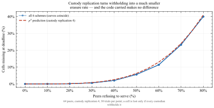
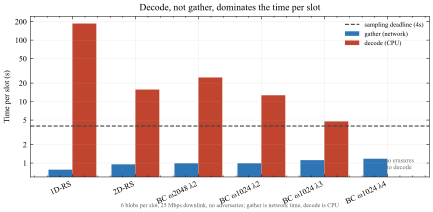

# What this project is, in one document

A plain-language tour of the problem, the three coding schemes, and how the
code measures them. Nothing here is new work — it assembles what is spread
across the other documents into one orientation piece.

---

## 1. The problem Ethereum has

Ethereum rollups post their data to the main chain. That data is bulky and
nobody needs it forever — they need to be *sure it was published* at the
time, so that anyone who wants to reconstruct the rollup's state later can.
EIP-4844 gave this its own container, the **blob**: 128 KiB of data attached
to a block, kept by the network for a couple of weeks and then dropped.

Every full node storing every blob does not scale. The plan, **PeerDAS**, is
that each node stores only a slice and checks availability by *sampling*: ask
for a few random pieces, and if they all arrive, conclude the whole blob is
probably out there.

Sampling only works if the data is **erasure coded** first. Here is why. If
you publish 4096 raw pieces and a malicious proposer withholds one, a sampler
asking for 30 random pieces almost certainly misses the missing one and
wrongly concludes everything is fine. But if you expand those 4096 pieces
into 8192 such that *any* 4096 of them rebuild the original, then withholding
becomes loud: to actually make the data unrecoverable the proposer must
withhold more than half of everything, and a sampler asking for 30 random
pieces will spot that with overwhelming probability.

So the erasure code is what turns "I checked a few pieces" into "the data is
available." **Which code you choose is the question this project asks.**

### What a blob actually is

A blob is **4096 field elements**. Each is a 32-byte number, but only 31
bytes are usable — the top byte is held back so that every element is
guaranteed to be smaller than the field's modulus. So one blob carries
4096 × 31 = **126,976 bytes** of application data.

Importantly, a blob stores the **evaluations** of a polynomial, not its
coefficients. This matters later.

---

## 2. The field, and the constraint that shapes everything

All arithmetic happens in the scalar field of the **BLS12-381** elliptic
curve: integers mod a 255-bit prime *p*, chosen because Ethereum's KZG
commitments live on that curve. We do not get to pick a friendlier field.

Fast encoding and decoding rely on the **Number Theoretic Transform** (NTT) —
an FFT over a finite field. An NTT of size *n* exists only if *n* divides
*p* − 1. For this field:

```
p - 1 = 2^32 · 3 · 11 · 19 · 10177 · 125527 · 859267 · 906349^2 · ... 
```

Note what is **missing**: there is no factor of 5, and none of 7. So:

* Any power of two up to 2³² is available. 4096, 8192, 65536 — all fine.
* 5120 = 2¹⁰ · 5 is **not**. Nor is 90 = 2 · 3² · 5, nor anything else
  needing a 5 or a 7.

This single fact is the recurring wall in the project. It rules out a 90×90
two-dimensional grid; it is why one of the block-circulant parameter sets
cannot use the fast decoder at all. Whenever something in this project looks
arbitrary, check whether a factor of 5 is the reason.

---

## 3. Reed-Solomon, from the ground up

Take your *k* data values and treat them as defining a single polynomial
*f* of degree less than *k*. Two facts from school algebra do all the work:

* A degree-<*k* polynomial is **completely determined by any *k* of its
  values**. Two points fix a line, three fix a parabola, and so on.
* You can evaluate that polynomial at as many points as you like.

So: evaluate *f* at *n* > *k* points and publish all *n* values. Lose any
*n* − *k* of them and the survivors still pin down *f* uniquely, so you
recover everything. A code with that property — where *any* *k* survivors
suffice — is called **MDS**, and it is the best any code can do.

### 1D-RS: the baseline

Treat the whole blob as one polynomial of degree < 4096 and evaluate it at
8192 points.

* **n = 8192, k = 4096**, rate 0.5, so 2× storage.
* MDS, so it tolerates exactly 50% erasure — the theoretical maximum.
* This is essentially what Ethereum actually does today.

The cost is that decoding involves one enormous polynomial division over an
8192-length object, and that is slow.

### 2D-RS: a product code

Arrange the blob as a 64×64 grid. Extend every **row** with Reed-Solomon,
then extend every **column** of the result.

In this project the grid extends to **88 × 96**, giving n = 8448 against
k = 4096 — a rate of 0.485 and 2.06× storage, close enough to 1D-RS to
compare fairly. (64→128 on both axes, the obvious choice, would give rate
0.25 and 4× storage, which would flatter 2D-RS by comparing a 4×-overhead
code against 2×-overhead ones.)

The interesting property is **iterative decoding**. A cell too damaged for
its row to recover alone may become recoverable once its column has run, and
vice versa; you alternate until nothing more can be fixed. The decode is many
short divisions rather than one long one, which is much cheaper.

The price is that a product code is **not MDS**. Its worst-case guarantee is
only about 10% erasure, even though in practice — against randomly scattered
losses rather than an adversary choosing the worst pattern — it does far
better.

### Block-circulant: buying locality

The third scheme comes from a 2026 paper (Sasidharan, Viterbo & Feist). The
idea is **locality**: with 1D-RS, repairing a single lost symbol means
touching the entire codeword. That is wasteful if you only need one piece.

A block-circulant code is built from *μ* blocks. Each parity block is
computed from only *λ* neighbouring information blocks, rather than from all
of them. So a small local group of symbols can be repaired by looking at that
group alone.

The parameters, which appear everywhere in the code:

| symbol | meaning |
|---|---|
| **ω** | information symbols per block |
| **ρ** | parity symbols per block (always ω here, giving rate 0.5) |
| **λ** | how many information blocks feed each parity block |
| **μ** | how many blocks in total |
| **n₀** | local block length, ρ + λω |

Overall this gives n = μ(ω + ρ) and k = μω. Five parameter sets are measured,
all at n = 8192 and rate 0.5, differing in how the same budget is carved up.

**The key prediction** is that the decoder's reach is set by λ alone:
it can repair up to a fraction **S₀ = 1/(1 + λ)** of the codeword. Larger λ
means each parity block draws on more information blocks — better locality
economics, but a *smaller* fraction of erasures the local phase can handle.

The decoder has two phases. **Phase 1** repairs each local block on its own.
**Phase 2** is supposed to handle harder cases by combining two adjacent
blocks. Phase 2 is where the implementation is incomplete, discussed in §8.

---

## 4. What "better" even means here

Six axes, from the project brief:

1. **Computational complexity** — how the cost grows with size
2. **Encoding / decoding efficiency** — actual measured seconds
3. **Storage overhead** — n/k, held at ~2× so comparisons are fair
4. **Bandwidth** — how much a node must fetch to rebuild
5. **Scalability** — behaviour as the network grows
6. **Fault tolerance** — how much loss survives

The point of holding storage overhead fixed is that otherwise every
comparison is meaningless: any code tolerates more erasure if you let it use
more space. Fixing the budget at 2× turns the question into *what do you get
for the same price?*

---

## 5. How the benchmark works

`benchmark_1D_2D_BC.py` runs all seven schemes (1D-RS, 2D-RS, five
block-circulant variants) through an identical procedure.

**The same real blob.** Random application bytes are packed into a real
EIP-4844 blob once, and every scheme encodes that same blob. Not seven
random inputs.

**The same erasure pattern.** For each target rate a mask is drawn marking
symbols as lost. Where two schemes share a codeword length — 1D-RS and the
BC rows are all n = 8192 — they are corrupted at *literally the same
positions*, which is the strictest form of a fair comparison.

**Success means bytes, not field elements.** A trial counts as a success only
if the recovered codeword round-trips all the way back to the exact original
application bytes. This matters more than it sounds: an early version of the
BC decoder returned zeros for values it had not actually solved and reported
success. Across 40 trials it claimed success every single time and was wrong
on 31 of them. Checking bytes rather than trusting the decoder's own flag is
what caught it.

**Trial counts vary deliberately.** More trials near a scheme's threshold,
where outcomes genuinely vary, fewer where the answer is always the same.

Each scheme is wrapped in an **adapter** exposing the same handful of
methods — `encode`, `random_mask`, `corrupt`, `decode`, `extract_message`.
The benchmark itself contains no coding logic; it drives adapters. That is
also what lets the network simulator reuse the identical code.

### What the sweep found

<figure>

<figcaption>Every scheme holds at 100% and then falls off a cliff, so a single threshold number fairly summarises each one. (a) Recovery against erasure probability; the pale band is the exact curve for 1D-RS, which the measured points sit on. (b) Thresholds with 95% confidence intervals: 1D-RS at 0.499, and the three &lambda;=2 rows within 0.013 of one another, rising slightly with &mu;.</figcaption>
</figure>

Measured thresholds: **1D-RS 0.499** (its theoretical maximum, as an MDS
code's should be — the exact value, 0.50006, is inside its interval),
**2D-RS 0.400**, the three **λ=2 rows 0.336–0.349**, **λ=3 0.255**,
**λ=4 0.204**. Each comes from a logistic fit to dense trials across that
scheme's transition band, with a 95% confidence interval of ±0.003 or
narrower.

The block-circulant numbers track the 1/(1+λ) prediction closely — 0.333,
0.250, 0.200 predicted against 0.336–0.349, 0.255, 0.204 measured — and
each sits just *above* its prediction, which is the right side: the
prediction is what one block repairs alone, and the cascade across blocks
can only add to it. At fixed λ=2 the threshold also rises slightly with μ,
for the same reason.

Note that 2D-RS at 0.400 sits **four times above** its own worst-case
guarantee of 0.10. That is not a contradiction: a minimum-distance guarantee
holds against every pattern including the adversarial worst case, while
these trials draw patterns at random. It is a useful reminder that a
guarantee and an expectation are different claims.

### The trade-off, in one picture

<figure>

<figcaption>Tolerance against what it costs to achieve. Down and to the right is better. Only three schemes are on the frontier &mdash; not beaten on both counts at once. Everything else is dominated: some other scheme tolerates more erasure <em>and</em> decodes faster. BC &omega;1024 &lambda;4 is the clearest case, beaten on both axes by BC &omega;512 &lambda;2, so the tolerance it gives up buys nothing back.</figcaption>
</figure>

If you read one figure in the project, read this one. It says: BC ω512 λ2 is
the cheapest thing that still survives a third of the codeword going missing;
2D-RS buys about five more points of tolerance for about 60% more decode time;
1D-RS buys the theoretical maximum and pays an order of magnitude for it.

One asymmetry worth holding onto: **encode is paid once, decode is paid by
everyone.** A blob is encoded by the proposer and decoded by every node that
reconstructs it. 1D-RS encodes in a quarter of a second and then costs 21 s
to decode; BC ω2048 λ2 spends 16 s encoding in order to decode in 6 s
(decode at 21% erasure, the highest rate every scheme still recovers). For
data availability sampling the second shape is the more useful one — an
argument for block-circulant that the tolerance numbers alone do not make.

---

## 6. The network simulation

The benchmark answers *what can this code survive?* It cannot answer *can a
node actually get the data and rebuild it before the slot ends?* Those are
different questions, and the second needs a network.

`network_sim.py` builds one with **SimPy**, a discrete-event simulator.
Nothing runs in real time: the simulation keeps a clock and an event queue,
and jumps straight from one event to the next, so simulating a 12-second slot
across 64 peers costs microseconds of real CPU.

What is modelled:

* **64 peers**, each cell held by **4 custodians**. A cell is lost only if
  *every* custodian withholds it.
* **Cells**, the unit PeerDAS actually requests: 64 field elements plus a
  48-byte KZG proof, 2096 bytes.
* **Adversaries** — a fraction of peers that never answer, so the client
  burns its request timeout before falling back to another custodian.
  Withholding costs the victim *time* as well as data.
* **A contended downlink**, so bandwidth saturation emerges from demand
  rather than being asserted.
* **A 4-second deadline** inside the 12-second slot.

The crucial design choice: in the benchmark, the erasure mask is an **input**
you invent. Here it is an **output** — whatever failed to arrive in time.
Everything downstream is the same adapter code.

<figure>

<figcaption>The first real finding of the network layer, and a slightly deflating one for the coding schemes. Because a cell needs all four of its custodians to withhold before it is lost, the erasure rate the code actually sees is roughly the <em>fourth power</em> of the fraction of bad peers. At 50% of the network withholding, the code sees about 6% erasure. All seven schemes produce the same curve, because this quantity is a property of the network and custody, not of the code being carried.</figcaption>
</figure>

This reframes things considerably. Custody replication absorbs most peer
failure before the erasure code is asked to do anything at all. The
differences in tolerance between schemes only start to matter once well over
half the network is hostile.

<figure>

<figcaption>The central result of the network layer. Every scheme gathers its data in about a second; decode runs from about 5&nbsp;s to 140&nbsp;s above that, and every scheme except one blows through the four-second deadline. Apart from the one scheme that avoids decoding altogether, the bottleneck is arithmetic &mdash; not bandwidth, not latency.</figcaption>
</figure>

That last figure is the one that should change how you read the rest of the
project. Bandwidth was the thing we expected to matter and it turns out not
to be close. **Decode speed is the binding constraint.**

---

## 7. What the code actually is

| file | what it does |
|---|---|
| `blob_generator.py` | real EIP-4844 blob packing; the shared field |
| `1D_RS_Galois.py`, `2D_RS_Galois.py` | the two Reed-Solomon schemes |
| `BCcodeEthereum.py` | block-circulant encoder and decoder |
| `benchmark_1D_2D_BC.py` | the seven-scheme erasure sweep |
| `network_sim.py` | the SimPy peer-to-peer layer |
| `fft_benchmark.py` | measures the NTT decoder path |
| `test_bc_fft.py` | structural checks on the BC decoder |
| `make_figures.py` | every figure, from the committed JSON |
| `make_docs.py` | every report, to PDF |

To run things:

```
pip install galois numpy simpy matplotlib

python3 benchmark_1D_2D_BC.py     # the erasure sweep (about 2 hours)
python3 network_sim.py            # the network layer (seconds)
python3 make_figures.py           # all figures (~40 seconds)
python3 make_docs.py              # all PDFs
```

The two sweeps write JSON, and everything downstream reads that JSON rather
than re-measuring. So the figures regenerate in seconds without re-running
anything, and a figure cannot quietly disagree with the table printed beside
it — they come from the same file.

---

## 8. Where the gaps are

Three things are genuinely incomplete, and it is worth knowing them.

**Block-circulant phase 2 does not apply to the benchmark's codes.** The
decoder's second phase builds the paper's auxiliary code over the union of
two adjacent blocks (Algorithm 1). But that construction needs the paper's
own layout of evaluation points, and the benchmark encodes every
parameterisation with a simpler shared layout so that all five rows stay
comparable. On those codes phase 2 never gets a turn: replaying every
block-circulant trial with the decoder's counters on showed it never ran,
because whenever phase 1 stalled, the pair left over was beyond the
256-unknown compute budget. Consequently **all five BC rows are measured as
single-phase decoders**, exactly, and their thresholds are what phase 1
achieves. Making phase 2
genuinely extend the reach — on a layout that also keeps the comparison
fair — is the highest-value piece of work left.

**The NTT decoder is correct but slower than the thing it replaces.** A
transform-based decoder was added for the block-circulant local phase, on the
reasoning that a fast transform should beat a direct solve. It turned out to
have never executed — a bug meant every call silently fell back — and once
fixed, it is 7 to 23 times *slower*. Profiling shows why: the transform is
only about 12% of the work, and roughly 80% is a polynomial division
implemented as a plain scalar loop. The asymptotic argument is sound; it just
does not reach the code yet. Replacing that division with Newton iteration is
the fix, and it is named in the source's own comments.

**One network topology.** The brief asks for "standard network architectures"
plural; the simulator models a single flat peer set. This is the one
requirement not met.

---

## 9. The short version

* Erasure coding is what makes availability *sampling* meaningful; without
  it, withholding one piece is undetectable.
* Everything is constrained by one field, and that field has no factor of 5
  or 7, which rules out parameter choices that otherwise look natural.
* **1D-RS** is optimal on tolerance and expensive to decode. **2D-RS** is
  cheap to decode and has a weak worst-case guarantee it comfortably beats
  in practice. **Block-circulant** buys repair locality, and its reach is
  set by λ — measured at 0.34, 0.255 and 0.204 for λ = 2, 3, 4, against a
  1/(1+λ) prediction of 0.333, 0.250, 0.200.
* Held at equal storage cost, only three of the seven schemes are on the
  cost-versus-tolerance frontier.
* In a simulated network, custody replication absorbs most peer failure
  before the code matters — the erasure seen is roughly p⁴ — and the
  binding constraint is decode arithmetic, not bandwidth.
